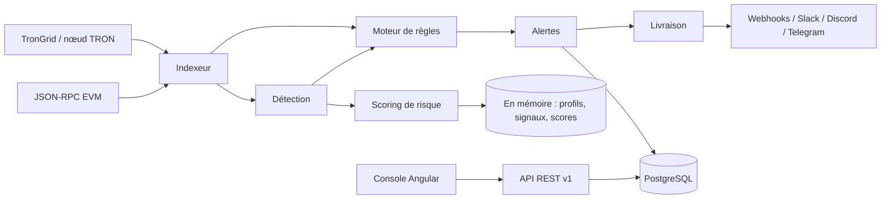

# OpenChain Intelligence

[English](README.md) · **Français**

**Investigation blockchain, renseignement sur les risques et surveillance programmable — open source et auto-hébergé.**

OpenChain Intelligence (OCI) surveille les blockchains TRON et EVM, détecte des signaux de risque explicables, attribue
aux portefeuilles un score dont chaque point est justifié, et vous permet d'écrire en YAML des règles de surveillance
qui déclenchent des alertes et préviennent vos systèmes (webhooks, Slack, Discord, Telegram). Tout tourne sur votre
propre machine ou votre serveur, avec Docker.

> **Statut : 0.1.0 — MVP non publié.** Le produit fonctionne de bout en bout, mais les API et les schémas peuvent
> encore évoluer avant la 1.0. Licence : [Apache-2.0](LICENSE).

**Sommaire :** [Ce que vous obtenez](#ce-que-vous-obtenez) · [Étape 1 — Forker et cloner](#étape-1--forker-et-cloner) ·
[Étape 2 — Installer les outils](#étape-2--installer-les-outils) · [Étape 3 — Essayer la démo](#étape-3--essayer-la-démo-5-minutes) ·
[Étape 4 — Passer en production](#étape-4--passer-en-production) · [Étape 5 — Développer](#étape-5--développer-et-tester) ·
[Étape 6 — Garder son fork à jour](#étape-6--garder-son-fork-à-jour) · [Dépannage](#dépannage) ·
[Architecture](#architecture) · [Contribuer](#contribuer)

---

## Ce que vous obtenez

| Domaine | Ce que le produit fait aujourd'hui |
|---|---|
| Ingestion | Indexeurs TRON et EVM (Ethereum, BSC, Polygon) avec confirmations et gestion des réorganisations de blocs : transferts de tokens (USDT, USDC…), transferts natifs des transactions réussies, approvals ERC-20/TRC-20, gels de stablecoins par l'émetteur (Tether, Circle — contrats officiels uniquement), changements de propriétaire de contrats |
| Investigation | Page wallet (profil, contreparties, signaux, labels), page transaction, graphe des flux de fonds (jusqu'à 3 sauts), historique ERC-20 récupéré à la demande pour une adresse que vous ouvrez |
| Risque | Détecteurs (structuration, transit rapide, montants inhabituels, réveil d'un wallet dormant, vidage rapide, dispersion, flux circulaires, exposition à des adresses listées, approvals illimités, gels par l'émetteur…) et un score de 0 à 100 dont chaque point cite sa source |
| Surveillance | Règles en YAML ou via un éditeur visuel, simulation sur les données enregistrées, versionnement, boîte de réception des alertes (acquitter, assigner, commenter, résoudre, faux positif) |
| Notifications | Webhooks signés (HMAC-SHA256, protégés contre le SSRF, avec nouvelles tentatives), Slack, Discord, Telegram |
| Plateforme | API REST v1, clés API (hachées, avec permissions, expiration et révocation) et OIDC en option, persistance PostgreSQL, flux de journal d'audit |

Pas encore disponible (en toute transparence) : les transactions internes et l'historique natif complet d'adresses
anciennes (il faut un nœud Erigon, voir l'[ADR-0020](docs/adr/0020-address-history-sources.md)), Bitcoin et Solana,
le multi-tenant, la limitation de débit de l'API, les métriques.

---

## Étape 1 — Forker et cloner

1. Sur GitHub, cliquez sur **Fork** sur ce dépôt pour obtenir votre propre copie.
2. Clonez **votre** fork (remplacez `VOTRE-COMPTE` et `VOTRE-FORK`) :

   ```bash
   git clone https://github.com/VOTRE-COMPTE/VOTRE-FORK.git
   cd VOTRE-FORK
   ```

3. Enregistrez le dépôt d'origine sous le nom `upstream`, pour récupérer les futures mises à jour (voir l'[étape 6](#étape-6--garder-son-fork-à-jour)) :

   ```bash
   git remote add upstream https://github.com/PROPRIETAIRE-ORIGINAL/DEPOT-ORIGINAL.git
   ```

---

## Étape 2 — Installer les outils

Pour **utiliser** OCI, Docker suffit. Pour le **développer**, il faut aussi Java, Maven et Node.js.

| Outil | Version | Utile pour | Vérifier avec |
|---|---|---|---|
| Docker Desktop (ou Docker Engine) avec Compose v2 | récente | tout faire tourner | `docker compose version` |
| JDK | 21 ou plus récent | compiler le backend | `java -version` |
| Maven | 3.9 ou plus récent | compiler le backend | `mvn -v` |
| Node.js | la version de `frontend/.nvmrc` (22.23.2) en local ; la CI et l'image Docker compilent avec Node 24 | compiler la console | `node -v` |

Conseils :
- Avec [nvm](https://github.com/nvm-sh/nvm), `cd frontend && nvm install && nvm use` sélectionne la bonne version de Node.
- Donnez au moins **4 Go de RAM** à Docker (Docker Desktop → Settings → Resources).
- Vérifiez que Docker **tourne** avant les étapes suivantes (`docker info` doit répondre).

---

## Étape 3 — Essayer la démo (5 minutes)

La démo tourne sur des blockchains **simulées**, avec des données **fictives** : aucun compte, aucune clé et aucun
accès réseau à une blockchain ne sont nécessaires.

1. Démarrez tout (le premier build prend quelques minutes) :

   ```bash
   docker compose up -d --build
   ```

2. Attendez que les trois services soient sains :

   ```bash
   docker compose ps          # app, frontend et postgres doivent afficher « healthy »
   ```

3. Récupérez la clé administrateur de démo. Elle n'est affichée **qu'une fois** dans les logs et reste valable 24 heures :

   ```bash
   docker compose logs app | grep "demo admin API key"
   ```

4. Ouvrez **http://localhost:4200**, allez dans **Settings → Connection**, choisissez **API key** et collez la clé.

5. Explorez :
   - **Overview** : ce qui se passe en ce moment.
   - **Alerts** : une boîte de réception ; sélectionnez une alerte pour voir pourquoi elle s'est déclenchée. Clavier : `J`/`K` pour naviguer, `E` pour acquitter, `Échap` pour fermer.
   - Cliquez sur une adresse pour ouvrir sa **page wallet** et l'explication de son score.
   - `⌘K` (ou `Ctrl K`) recherche une adresse, une transaction ou une page ; `?` affiche tous les raccourcis.
   - Six scénarios scriptés montrent toute la chaîne *événement → signal → score → règle → alerte → notification* :
     `curl -s -H "X-API-Key: <votre clé>" http://localhost:4200/api/v1/demo/scenarios`

6. Arrêtez quand vous avez terminé :

   ```bash
   docker compose down         # conserve les données
   docker compose down -v      # supprime aussi les données (alertes, clés, règles de démo)
   ```

Une visite guidée détaillée se trouve dans [docs/guides/quickstart.md](docs/guides/quickstart.md) (en anglais).

---

## Étape 4 — Passer en production

En production, OCI lit de **vraies** blockchains et ne contient **aucune donnée de démo**. Tout se configure dans un
seul fichier, `.env`.

### 4.1 Créer votre `.env`

```bash
cp deploy/.env.example .env
```

`.env` est ignoré par git : il contient des secrets, **ne le committez jamais**.

### 4.2 Renseigner les valeurs obligatoires

Ouvrez `.env` et renseignez :

| Variable | Valeur à mettre | Comment la générer |
|---|---|---|
| `OCI_DEMO_MODE` | `false` | — |
| `POSTGRES_PASSWORD` | un long mot de passe aléatoire | `openssl rand -base64 32` |
| `OCI_CRYPTO_MASTER_KEY` | chiffre les secrets des connecteurs | `openssl rand -base64 32` |
| `OCI_SECURITY_API_KEY_PEPPER` | sert à hacher les clés API | `openssl rand -base64 48` |
| `OCI_ADMIN_API_KEY` | votre clé administrateur | voir la commande ci-dessous |

Clé administrateur (format `oci_live_<8 caractères>_<43 caractères>`) :

```bash
echo "oci_live_$(LC_ALL=C tr -dc A-Za-z0-9 </dev/urandom | head -c 8)_$(LC_ALL=C tr -dc A-Za-z0-9 </dev/urandom | head -c 43)"
```

Conservez la clé maître et le pepper en lieu sûr et ne les changez pas : si vous les perdez ou les modifiez, les
secrets des connecteurs et les clés API enregistrés deviennent inutilisables. En production, l'application **refuse de
démarrer** si l'un d'eux manque, ou si vous réutilisez les valeurs publiques de la démo.

### 4.3 Choisir vos blockchains

Activez au moins un réseau, sinon il n'y a rien à indexer :

```bash
# Ethereum : n'importe quel endpoint JSON-RPC (votre nœud, Alchemy, Infura, ou un endpoint public pour essayer)
OCI_CHAINS_ETHEREUM_ENABLED=true
OCI_CHAINS_ETHEREUM_URL=https://ethereum-rpc.publicnode.com

# TRON : TronGrid ; une clé gratuite obtenue sur trongrid.io augmente les quotas
OCI_CHAINS_TRON_ENABLED=true
OCI_CHAINS_TRON_URL=https://api.trongrid.io
OCI_CHAINS_TRON_API_KEY=
```

Les endpoints publics suffisent pour essayer, mais leur débit est **limité** : l'indexation peut prendre du retard.
Pour un usage réel, prenez une clé chez un fournisseur ou faites tourner votre propre nœud.

### 4.4 Démarrer

Si vous avez lancé la démo auparavant, supprimez d'abord ses données pour qu'aucune donnée fictive ne subsiste :

```bash
docker compose down -v
```

Puis démarrez en mode production :

```bash
docker compose up -d --build
docker compose ps
docker compose logs app | grep -E "Persistence mode|Started|ERROR"
```

Ouvrez **http://localhost:4200**, allez dans **Settings → Connection → API key** et collez votre `OCI_ADMIN_API_KEY`.
Créez ensuite des clés plus restreintes pour vos collègues et vos intégrations dans **Settings → API keys**.

À quoi vous attendre au début : OCI indexe à partir du bloc courant, les pages se remplissent donc au fil des nouveaux
blocs. Quand vous ouvrez une adresse, ses transferts ERC-20 et ses approvals passés sont récupérés à la demande ; ses
anciens transferts natifs restent invisibles tant que vous ne branchez pas un nœud Erigon
([ADR-0020](docs/adr/0020-address-history-sources.md)).

### 4.5 Avant de l'ouvrir sur un réseau

La stack Compose est prévue pour une seule machine. Avant de donner l'accès à d'autres personnes, lisez
[docs/guides/security-hardening.md](docs/guides/security-hardening.md) (en anglais) : placez-la derrière HTTPS (reverse
proxy), n'exposez pas les ports 8080 ni 5432 sur internet, sauvegardez PostgreSQL **et** la clé maître, et utilisez OIDC
pour la connexion des utilisateurs si vous avez un fournisseur d'identité. Tous les réglages sont décrits dans
[docs/guides/installation.md](docs/guides/installation.md) (en anglais).

---

## Étape 5 — Développer et tester

### Compiler et tout tester

```bash
mvn -B clean verify                           # backend : compile et lance tous les tests
```

Laissez Docker tourner : les tests d'intégration PostgreSQL démarrent une base temporaire avec Testcontainers. Sans
Docker, ils sont **sautés** (le build affiche quand même SUCCESS) : vérifiez que le rapport indique `Skipped: 0`.

```bash
cd frontend
nvm use                                       # version de Node définie dans .nvmrc
npm ci                                        # installe les versions exactes des dépendances
npm test                                      # tests unitaires
npm run build                                 # build de production
cd ..
```

Vérification de bout en bout de la stack Docker : le script construit les images, démarre une stack de démo séparée,
la teste, la redémarre puis l'arrête. Arrêtez d'abord votre propre stack, car elle utilise les mêmes ports :

```bash
docker compose down
bash deploy/smoke-test.sh
```

### Lancer le backend et la console depuis les sources

Terminal 1 — le backend en mode démo, sans Docker :

```bash
mvn -q -B install -DskipTests
mvn -pl oci-app spring-boot:run               # http://localhost:8080
```

Terminal 2 — la console avec rechargement à chaud, branchée sur ce backend :

```bash
cd frontend
npm run start:api                             # http://localhost:4200
```

Dans cette configuration, la clé de la console est la clé de développement documentée
`oci_demo_devui001_DemoOnlyAngularDevServerKeyNotSecret0001` (profil démo uniquement, jamais valable en production).

`npm start` (au lieu de `start:api`) lance la console seule, sur des données factices intégrées : pratique pour le
travail purement visuel.

### Organisation du dépôt

```
oci-core/          modèle de domaine partagé par tous les modules (sans framework)
oci-blockchain/    adaptateurs TRON et EVM, indexeur de blocs, gestion des réorganisations
oci-intelligence/  détecteurs, scoring de risque, labels
oci-alerting/      langage de règles, moteur de règles, alertes, connecteurs de notification
oci-app/           application Spring Boot : API REST, sécurité, persistance, mode démo
frontend/          console Angular
rules/             pack de règles communautaires (YAML), chargé au démarrage
deploy/            Dockerfiles, configuration nginx, .env.example, test de fumée
docs/              architecture, décisions (ADR), contrat d'API, guides
```

Une règle ressemble à ceci (plus de détails dans [docs/guides/writing-rules.md](docs/guides/writing-rules.md), en anglais) :

```yaml
apiVersion: openchain.io/rule/v1
id: usdt-burst-outflow
version: 1.0.0
name: USDT burst outflow
author: your-team
scope:
  networks: [tron]
  eventTypes: [TOKEN_TRANSFER]
conditions:
  logic: AND
  rules:
    - { field: transaction.token.symbol, operator: EQUALS, value: USDT }
aggregation:                      # SOMME sur une fenêtre glissante d'1 h, par émetteur
  window: 1h
  groupBy: [transaction.from]
  function: SUM
  field: transaction.amount
  operator: GREATER_THAN_OR_EQUAL
  threshold: "50000"
severity: HIGH
cooldown: 6h
actions:
  - { type: WEBHOOK, connectorId: ops-webhook }
```

---

## Étape 6 — Garder son fork à jour

```bash
git fetch upstream
git checkout main
git merge upstream/main          # ou : git rebase upstream/main
git push origin main
```

Reconstruisez ensuite : `docker compose up -d --build`. Les migrations de la base s'appliquent automatiquement au
démarrage ; en production, sauvegardez PostgreSQL avant. Lisez le [CHANGELOG.md](CHANGELOG.md) (en anglais) pour
repérer les changements qui demandent votre attention.

---

## Dépannage

| Symptôme | Cause et solution |
|---|---|
| `Cannot connect to the Docker daemon` | Docker ne tourne pas. Lancez Docker Desktop et attendez que `docker info` réponde. |
| `port is already allocated` (8080, 4200 ou 5432) | Un autre programme utilise le port. Arrêtez-le, ou arrêtez l'autre stack avec `docker compose down`. |
| Le conteneur de l'application redémarre en boucle | Lisez `docker compose logs app`. En production, un `OCI_CRYPTO_MASTER_KEY` ou un `OCI_SECURITY_API_KEY_PEPPER` manquant ou égal aux valeurs de démo est refusé au démarrage, avec un message explicite. |
| `401` / « missing or invalid credentials » dans la console | Aucune clé, ou une clé expirée. Démo : reprenez la clé la plus récente dans les logs (une nouvelle est générée à chaque démarrage). Production : recollez `OCI_ADMIN_API_KEY`. |
| « network 'bsc' is not enabled on this instance » | Vous avez ouvert une adresse sur un réseau que cette instance n'indexe pas. Ouvrez-la sur un réseau activé, ou activez ce réseau dans `.env`. |
| Une adresse n'affiche aucune transaction | En mode démo, seules les adresses simulées existent. En production, l'historique est récupéré à la demande quand vous ouvrez l'adresse ; les anciens transferts natifs nécessitent un nœud Erigon (ADR-0020). |
| L'indexation prend du retard | Les endpoints publics ont un débit limité. Utilisez une clé fournisseur (`OCI_CHAINS_TRON_API_KEY`, une URL RPC payante) ou votre propre nœud. |
| Les tests backend affichent `Skipped:` supérieur à 0 pour `oci-app` | Docker ne tournait pas pendant `mvn verify` : les tests PostgreSQL ont été sautés. Démarrez Docker et relancez. |
| `npm` / Angular refuse votre version de Node | Utilisez la version de `frontend/.nvmrc` (`nvm use`). |
| Je veux repartir de zéro | `docker compose down -v` supprime toutes les données (clés, règles, alertes). |

---

## Architecture

Un monolithe modulaire : une application Java 21 / Spring Boot composée de modules indépendants, une console Angular
et PostgreSQL. Les événements de la blockchain passent par l'indexeur, puis par la détection et le scoring, puis par
le moteur de règles, qui déclenche les alertes et envoie les notifications via une file sortante (outbox).



Pour aller plus loin (documents en anglais) : [vue d'ensemble de l'architecture](docs/architecture/overview.md) ·
[modèle de données](docs/architecture/data-model.md) · [moteur de règles](docs/architecture/rule-engine.md) ·
[contrat d'API](docs/api/README.md) · [décisions d'architecture (ADR)](docs/adr/) ·
[politique de licences](docs/adr/0012-licensing-policy.md) · [stratégie de test](docs/testing-strategy.md)

---

## Contribuer

Les contributions de code, de règles et de documentation sont les bienvenues. Lisez [CONTRIBUTING.md](CONTRIBUTING.md)
(les commits doivent être signés, DCO) et le [code de conduite](CODE_OF_CONDUCT.md). Signalez les failles de sécurité
en privé, comme décrit dans [SECURITY.md](SECURITY.md).

## Avertissement

Les résultats d'OCI sont des indicateurs de risque issus de données publiques de la blockchain et de sources tierces
attribuées. Ce ne sont pas des décisions juridiques, ils n'identifient aucune personne, et ils doivent être examinés
par une personne qualifiée avant toute décision concernant quelqu'un.
