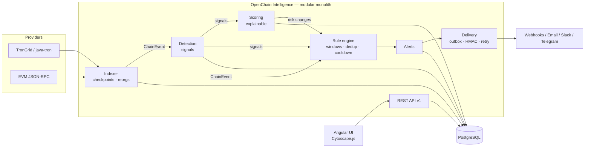

# OpenChain Intelligence

**Open source blockchain investigation, risk intelligence and programmable monitoring.**

OpenChain Intelligence (OCI) indexes token flows on TRON and EVM chains, detects explainable risk signals, scores wallets with traceable contributions, and lets you declare monitoring rules in YAML that raise alerts and call your systems through signed webhooks — all self-hostable with `docker compose up`.

> **Status: 0.1.0 — unreleased MVP.** APIs and schemas may change before 1.0. See the module status table below.

Licence: [Apache-2.0](LICENSE).

## Why OCI

- **Explainable by design** — every risk point and every alert links to evidence: transactions, rule version, source, timestamp.
- **Honest about evidence** — signals are tagged `ANOMALY`, `RISK_SIGNAL` or `CONFIRMED_BY_SOURCE`. OCI never labels an address as criminal.
- **Programmable, safely** — rules are declarative data (`oci.rules/v1`): filters, sliding windows, group-by, dedup, cooldown. No scripting, no code execution.
- **Reorg-aware** — confirmations are first-class; alerts depending on orphaned blocks are retracted.
- **Exact amounts** — `BigInteger`/`BigDecimal` end to end.
- **Multi-chain** — one provider SPI, failover and rate limiting; TRON and EVM first.
- **Open and portable** — Apache-2.0, PostgreSQL, OpenTelemetry, any OIDC provider.

## Features

| Area | Capabilities |
|---|---|
| Investigation | Wallet analysis (profile, counterparties, signals, labels), transaction analysis, counterparty graph explorer (depth ≤ 3) |
| Risk intelligence | Detectors for transaction patterns (structuring, fast forwarding, unusual amounts…), wallet patterns (dormant reactivation, rapid drain…), exposure (sanctioned/flagged, direct and indirect); explainable 0–100 score |
| Monitoring | YAML/JSON rules, DRY_RUN on history, versioning, alert lifecycle (acknowledge, assign, comment, resolve, false positive) |
| Notifications | Webhooks (HMAC-SHA256, SSRF-guarded, retries), email, Slack, Telegram |
| Platform | REST API v1 (problem+json, cursor pagination, idempotency keys, rate-limit headers), OIDC + API keys, RBAC, tenant isolation, audit log, Prometheus metrics, OpenTelemetry traces |

## Architecture



Details: [architecture overview](docs/architecture/overview.md) · [C4 model](docs/architecture/c4/) · [sequences](docs/architecture/sequences.md) · [data model](docs/architecture/data-model.md) · [rule engine](docs/architecture/rule-engine.md) · [ADRs](docs/adr/).

## Quickstart

Requirements: Docker with Compose v2.

```bash
git clone https://github.com/openchain-intelligence/openchain-intelligence.git
cd openchain-intelligence
docker compose up -d --build
# UI:  http://localhost:4200
# API: http://localhost:8080/api/v1  · health: http://localhost:8080/actuator/health
```

This starts in **demo mode** (`OCI_DEMO_MODE=true`) on a simulated chain — no provider keys required. Walk through it in the [quickstart guide](docs/guides/quickstart.md). For a real deployment read [installation](docs/guides/installation.md) and [security hardening](docs/guides/security-hardening.md).

A rule looks like this:

```yaml
apiVersion: oci.rules/v1
kind: Rule
metadata: { name: usdt-burst-outflow, severity: HIGH }
spec:
  networks: [tron]
  eventTypes: [TOKEN_TRANSFER]
  where:
    all: [ { field: transaction.token.symbol, op: eq, value: USDT } ]
  window: { type: sliding, size: 1h, groupBy: [transaction.from] }
  having:
    all:
      - { aggregate: count, op: gte, value: 5 }
      - { aggregate: sum, field: transaction.amount, op: gte, value: "50000" }
  dedup: { cooldown: 6h }
  actions: [ { connector: ops-webhook } ]
```

## Module status

| Module | Purpose | Status |
|---|---|---|
| `oci-core` | Framework-free domain model + `BlockchainProvider` SPI | **MVP** — implemented, tested |
| `oci-blockchain` | TRON (TronGrid-compatible) and EVM JSON-RPC providers, failover, indexer, reorg handling | **MVP** — in progress |
| `oci-intelligence` | Detectors, explainable risk scoring, graph exposure | **MVP** — in progress |
| `oci-alerting` | Rule DSL v1, evaluator (windows, dedup, cooldown), alert lifecycle, connectors | **MVP** — in progress |
| `oci-app` | Spring Boot app: REST API v1, security, persistence, demo mode | **MVP** — in progress |
| `frontend` | Angular UI: analysis, graph explorer, rules, alerts | **MVP** — in progress |
| Bitcoin / Solana providers | UTXO and slot-based chains | *planned* |
| Kafka transport, ClickHouse analytics, Apache AGE graph | Scale-out options | *planned* ([ADR-0004](docs/adr/0004-postgresql-first-clickhouse-later.md), [0005](docs/adr/0005-graph-store.md), [0006](docs/adr/0006-event-bus-outbox-kafka-later.md)) |
| Helm chart | Kubernetes deployment | *planned* |

## Documentation

- [API v1 contract](docs/api/README.md) — endpoints, auth, errors, pagination, webhook verification
- [Writing rules](docs/guides/writing-rules.md)
- [Technology choices](docs/technology-choices.md) and [licensing policy](docs/adr/0012-licensing-policy.md)
- [Testing strategy](docs/testing-strategy.md)

## Build from source

```bash
mvn -B verify                                     # JDK 21 (Docker needed for integration tests)
cd frontend && npm ci && npm run build && npm test
```

## Contributing

Contributions of code, rules and docs are welcome — see [CONTRIBUTING.md](CONTRIBUTING.md) (DCO sign-off required) and the [Code of Conduct](CODE_OF_CONDUCT.md). Security issues: [SECURITY.md](SECURITY.md).

## Disclaimer

OCI outputs are risk indicators derived from public blockchain data and attributed third-party sources. They are not legal determinations, do not identify any person, and must be reviewed by a qualified human before any decision affecting someone.
