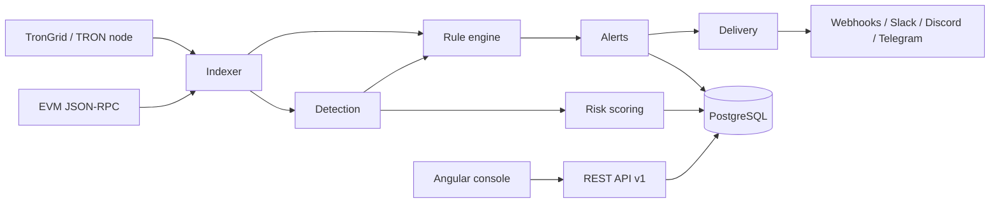

# OpenChain Intelligence

**English** · [Français](README.fr.md)

**Open source blockchain investigation, risk intelligence and programmable monitoring — self-hosted.**

OpenChain Intelligence (OCI) watches TRON and EVM blockchains, detects risk signals you can explain, scores wallets
with traceable contributions, and lets you write monitoring rules in YAML that raise alerts and notify your systems
(webhooks, Slack, Discord, Telegram). Everything runs on your own machine or server with Docker.

> **Status: 0.1.0 — unreleased MVP.** It works end to end, but APIs and schemas may still change before 1.0.
> Licence: [Apache-2.0](LICENSE).

**Contents:** [What you get](#what-you-get) · [Step 1 — Fork and clone](#step-1--fork-and-clone) ·
[Step 2 — Install the tools](#step-2--install-the-tools) · [Step 3 — Try the demo](#step-3--try-the-demo-5-minutes) ·
[Step 4 — Run it for real](#step-4--run-it-for-real-production) · [Step 5 — Develop](#step-5--develop-and-test) ·
[Step 6 — Keep your fork up to date](#step-6--keep-your-fork-up-to-date) · [Troubleshooting](#troubleshooting) ·
[How it is built](#how-it-is-built) · [Contributing](#contributing)

---

## What you get

| Area | What it does today |
|---|---|
| Ingestion | TRON and EVM (Ethereum, BSC, Polygon) indexers with confirmations and reorg handling: token transfers (USDT, USDC…), native transfers of successful transactions, ERC-20/TRC-20 approvals, stablecoin issuer freezes (Tether, Circle — official contracts only), contract ownership changes |
| Investigation | Wallet page (profile, counterparties, signals, labels), transaction page, fund-flow graph (up to 3 hops), on-demand ERC-20 history of an address you open |
| Risk | Detectors (structuring, fast forwarding, unusual amounts, dormant reactivation, rapid drain, fan-out, circular flows, exposure to listed addresses, unlimited approvals, issuer freezes…) and a 0–100 score where every point names its source |
| Monitoring | Rules as YAML or with a visual builder, dry-run simulation on recorded data, versioning, alert inbox (acknowledge, assign, comment, resolve, false positive) |
| Notifications | Signed webhooks (HMAC-SHA256, SSRF-guarded, retries), Slack, Discord, Telegram |
| Platform | REST API v1, API keys (hashed, scoped, expiring, revocable) and optional OIDC, PostgreSQL persistence, audit log stream |

Not there yet (honestly): internal transactions and full native history of old addresses (needs an Erigon node, see
[ADR-0020](docs/adr/0020-address-history-sources.md)), Bitcoin and Solana, multi-tenancy, rate limiting, metrics.

---

## Step 1 — Fork and clone

1. On GitHub, click **Fork** on this repository to get your own copy.
2. Clone **your** fork (replace `YOUR-ACCOUNT` and `YOUR-FORK`):

   ```bash
   git clone https://github.com/YOUR-ACCOUNT/YOUR-FORK.git
   cd YOUR-FORK
   ```

3. Remember the original repository as `upstream`, so you can pull future updates (see [Step 6](#step-6--keep-your-fork-up-to-date)):

   ```bash
   git remote add upstream https://github.com/ORIGINAL-OWNER/ORIGINAL-REPOSITORY.git
   ```

---

## Step 2 — Install the tools

To **run** OCI you only need Docker. To **develop** it you also need Java, Maven and Node.js.

| Tool | Version | Needed for | Check with |
|---|---|---|---|
| Docker Desktop (or Docker Engine) with Compose v2 | recent | running everything | `docker compose version` |
| JDK | 21 or newer | building the backend | `java -version` |
| Maven | 3.9 or newer | building the backend | `mvn -v` |
| Node.js | exactly the version in `frontend/.nvmrc` (22.23.2) | building the console | `node -v` |

Tips:
- With [nvm](https://github.com/nvm-sh/nvm), `cd frontend && nvm install && nvm use` picks the right Node version.
- Give Docker at least **4 GB of RAM** (Docker Desktop → Settings → Resources).
- Make sure Docker is **running** before the next steps (`docker info` must answer).

---

## Step 3 — Try the demo (5 minutes)

The demo runs on **simulated** blockchains with **fictitious** data, so you need no account, no key and no internet
access to a blockchain.

1. Start everything (the first build takes a few minutes):

   ```bash
   docker compose up -d --build
   ```

2. Wait until the three services are healthy:

   ```bash
   docker compose ps          # app, frontend and postgres should show "healthy"
   ```

3. Get the demo administrator key. It is printed **once** in the logs and is valid 24 hours:

   ```bash
   docker compose logs app | grep "demo admin API key"
   ```

4. Open **http://localhost:4200**, go to **Settings → Connection**, choose **API key** and paste the key.

5. Explore:
   - **Overview**: what is happening right now.
   - **Alerts**: an inbox; select an alert to see why it fired. Keyboard: `J`/`K` to move, `E` to acknowledge, `Esc` to close.
   - Click an address to open its **wallet page** and the explanation of its score.
   - `⌘K` (or `Ctrl K`) searches an address, a transaction or a page; `?` lists all shortcuts.
   - Six scripted scenarios show the whole chain *event → signal → score → rule → alert → notification*:
     `curl -s -H "X-API-Key: <your key>" http://localhost:4200/api/v1/demo/scenarios`

6. Stop it when you are done:

   ```bash
   docker compose down         # keeps the data
   docker compose down -v      # also deletes the data (demo alerts, keys, rules)
   ```

A guided tour is in [docs/guides/quickstart.md](docs/guides/quickstart.md).

---

## Step 4 — Run it for real (production)

In production OCI reads **real** blockchains and contains **no demo data**. You configure everything in one file, `.env`.

### 4.1 Create your `.env`

```bash
cp deploy/.env.example .env
```

`.env` is ignored by git: it holds secrets, **never commit it**.

### 4.2 Fill in the required values

Open `.env` and set:

| Variable | What to put | How to generate |
|---|---|---|
| `OCI_DEMO_MODE` | `false` | — |
| `POSTGRES_PASSWORD` | a long random password | `openssl rand -base64 32` |
| `OCI_CRYPTO_MASTER_KEY` | encrypts connector secrets | `openssl rand -base64 32` |
| `OCI_SECURITY_API_KEY_PEPPER` | used to hash API keys | `openssl rand -base64 48` |
| `OCI_ADMIN_API_KEY` | your administrator key | see the command below |

Administrator key (format `oci_live_<8 characters>_<43 characters>`):

```bash
echo "oci_live_$(LC_ALL=C tr -dc A-Za-z0-9 </dev/urandom | head -c 8)_$(LC_ALL=C tr -dc A-Za-z0-9 </dev/urandom | head -c 43)"
```

Keep the master key and the pepper safe and stable: if you lose or change them, stored connector secrets and API keys
become unusable. The application **refuses to start** in production if one of them is missing or if you reuse the
public demo values.

### 4.3 Choose your blockchains

Enable at least one network, otherwise there is nothing to index:

```bash
# Ethereum: any JSON-RPC endpoint (your own node, Alchemy, Infura, or a public endpoint to try)
OCI_CHAINS_ETHEREUM_ENABLED=true
OCI_CHAINS_ETHEREUM_URL=https://ethereum-rpc.publicnode.com

# TRON: TronGrid; a free key from trongrid.io gives higher limits
OCI_CHAINS_TRON_ENABLED=true
OCI_CHAINS_TRON_URL=https://api.trongrid.io
OCI_CHAINS_TRON_API_KEY=
```

Public endpoints are fine to try but are **rate-limited**: indexing may lag. For real use, take a provider key or
run your own node.

### 4.4 Start

If you ran the demo before, delete its data first so no fictitious data remains:

```bash
docker compose down -v
```

Then start in production mode:

```bash
docker compose up -d --build
docker compose ps
docker compose logs app | grep -E "Persistence mode|Started|ERROR"
```

Open **http://localhost:4200**, go to **Settings → Connection → API key** and paste your `OCI_ADMIN_API_KEY`.
Then create narrower keys for your colleagues and integrations in **Settings → API keys**.

What to expect at first: OCI indexes from the current block onwards, so pages fill up as new blocks arrive. When you
open an address, its past ERC-20 transfers and approvals are fetched on demand; its older native transfers stay
invisible unless you connect an Erigon node ([ADR-0020](docs/adr/0020-address-history-sources.md)).

### 4.5 Before exposing it on a network

The Compose stack is meant for a single machine. Before giving access to others, read
[docs/guides/security-hardening.md](docs/guides/security-hardening.md): put it behind HTTPS (reverse proxy), do not
expose ports 8080 or 5432 to the internet, back up PostgreSQL **and** the master key, and use OIDC for user sign-in if
you have an identity provider. All settings are described in [docs/guides/installation.md](docs/guides/installation.md).

---

## Step 5 — Develop and test

### Build and test everything

```bash
mvn -B clean verify                           # backend: builds and runs all tests
```

Keep Docker running: the PostgreSQL integration tests start a temporary database with Testcontainers. Without Docker
they are **skipped** (the build still says SUCCESS), so check that the report shows `Skipped: 0`.

```bash
cd frontend
nvm use                                       # Node version from .nvmrc
npm ci                                        # install exact dependency versions
npm test                                      # unit tests
npm run build                                 # production build
cd ..
```

End-to-end check of the Docker stack (it builds the images, starts a separate demo stack, tests it, restarts it and
stops it; stop your own stack first because it uses the same ports):

```bash
docker compose down
bash deploy/smoke-test.sh
```

### Run the backend and the console from source

Terminal 1 — the backend in demo mode, without Docker:

```bash
mvn -q -B install -DskipTests
mvn -pl oci-app spring-boot:run               # http://localhost:8080
```

Terminal 2 — the console with live reload, talking to that backend:

```bash
cd frontend
npm run start:api                             # http://localhost:4200
```

In this setup, the console key is the documented development key
`oci_demo_devui001_DemoOnlyAngularDevServerKeyNotSecret0001` (demo profile only, never valid in production).

`npm start` (instead of `start:api`) runs the console alone on built-in mock data — handy for pure UI work.

### Where things are

```
oci-core/          domain model shared by all modules (no framework)
oci-blockchain/    TRON and EVM adapters, block indexer, reorg handling
oci-intelligence/  detectors, risk scoring, labels
oci-alerting/      rule language, rule engine, alerts, notification connectors
oci-app/           Spring Boot application: REST API, security, persistence, demo mode
frontend/          Angular console
rules/             community rule pack (YAML), loaded at startup
deploy/            Dockerfiles, nginx config, .env.example, smoke test
docs/              architecture, decisions (ADRs), API contract, guides
```

A rule looks like this (more in [docs/guides/writing-rules.md](docs/guides/writing-rules.md)):

```yaml
apiVersion: openchain.io/rule/v1
id: usdt-burst-outflow
version: 1.0.0
name: USDT burst outflow
author: your-team
scope:
  networks: [tron]
  eventTypes: [TOKEN_TRANSFER]
conditions:
  logic: AND
  rules:
    - { field: transaction.token.symbol, operator: EQUALS, value: USDT }
aggregation:                      # SUM over a sliding 1h window, per sender
  window: 1h
  groupBy: [transaction.from]
  function: SUM
  field: transaction.amount
  operator: GREATER_THAN_OR_EQUAL
  threshold: "50000"
severity: HIGH
cooldown: 6h
actions:
  - { type: WEBHOOK, connectorId: ops-webhook }
```

---

## Step 6 — Keep your fork up to date

```bash
git fetch upstream
git checkout main
git merge upstream/main          # or: git rebase upstream/main
git push origin main
```

Then rebuild: `docker compose up -d --build`. Database migrations run automatically at startup; back up PostgreSQL
first in production. Read [CHANGELOG.md](CHANGELOG.md) for changes that need your attention.

---

## Troubleshooting

| Symptom | Cause and fix |
|---|---|
| `Cannot connect to the Docker daemon` | Docker is not running. Start Docker Desktop and wait until `docker info` answers. |
| `port is already allocated` (8080, 4200 or 5432) | Another program uses the port. Stop it, or stop the other stack with `docker compose down`. |
| The app container restarts in a loop | Read `docker compose logs app`. In production, a missing or demo `OCI_CRYPTO_MASTER_KEY` / `OCI_SECURITY_API_KEY_PEPPER` is refused at startup with an explicit message. |
| `401` / "missing or invalid credentials" in the console | No key or an expired one. Demo: get the newest key from the logs (a new one is generated at each start). Production: paste `OCI_ADMIN_API_KEY` again. |
| "network 'bsc' is not enabled on this instance" | You opened an address on a network this instance does not index. Open it on an enabled network, or enable that network in `.env`. |
| An address shows no transactions | In demo mode only simulated addresses exist. In production, history is fetched on demand when you open the address; older native transfers need an Erigon node (ADR-0020). |
| Indexing lags behind | Public endpoints are rate-limited. Use a provider key (`OCI_CHAINS_TRON_API_KEY`, a paid RPC URL) or your own node. |
| Backend tests show `Skipped:` above 0 for `oci-app` | Docker was not running during `mvn verify`; the PostgreSQL tests were skipped. Start Docker and run again. |
| `npm` / Angular refuses your Node version | Use the version in `frontend/.nvmrc` (`nvm use`). |
| I want to start from scratch | `docker compose down -v` deletes all data (keys, rules, alerts). |

---

## How it is built

A modular monolith: one Java 21 / Spring Boot application made of independent modules, an Angular console, and
PostgreSQL. Blockchain events flow through the indexer to detection and scoring, then to the rule engine, which raises
alerts and delivers notifications through an outbox.



More: [architecture overview](docs/architecture/overview.md) · [data model](docs/architecture/data-model.md) ·
[rule engine](docs/architecture/rule-engine.md) · [API contract](docs/api/README.md) ·
[architecture decisions (ADRs)](docs/adr/) · [licensing policy](docs/adr/0012-licensing-policy.md) ·
[testing strategy](docs/testing-strategy.md)

---

## Contributing

Contributions of code, rules and documentation are welcome. Read [CONTRIBUTING.md](CONTRIBUTING.md) (commits must be
signed off, DCO) and the [Code of Conduct](CODE_OF_CONDUCT.md). Report security issues privately as described in
[SECURITY.md](SECURITY.md).

## Disclaimer

OCI outputs are risk indicators derived from public blockchain data and attributed third-party sources. They are not
legal determinations, do not identify any person, and must be reviewed by a qualified human before any decision
affecting someone.
