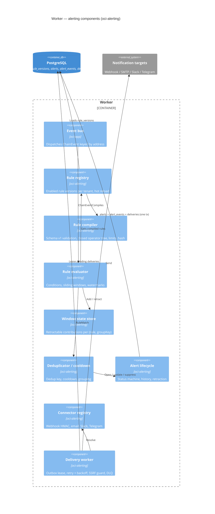

# C4 — Level 3: Components of the alerting pipeline

Source of truth: [`workspace.dsl`](workspace.dsl) (view `AlertingComponents`). Implemented in module `oci-alerting`, wired by `oci-app`. Detailed behaviour: [rule-engine.md](../rule-engine.md).

## Key contracts between components

| From → To | Contract |
|---|---|
| Bus → Evaluator | `ChainEvent` (deterministic `eventId`, `eventTime`, `removed`, flat `fields`) |
| Registry → Evaluator | `CompiledRule` (immutable; `ruleId`, `version`, `sourceHash`, predicate tree, window spec, dedup spec) |
| Evaluator → Deduplicator | `RuleMatch(ruleId, version, groupKey, windowStart, windowEnd, contributingEventIds, explanation)` |
| Deduplicator → Alerts | open / append-occurrence / suppress decision with `dedupKey` |
| Alerts → Delivery | `deliveries` row (`connector_id`, `payload`, `idempotency_key = alertId:connectorId:eventSeq`) |
