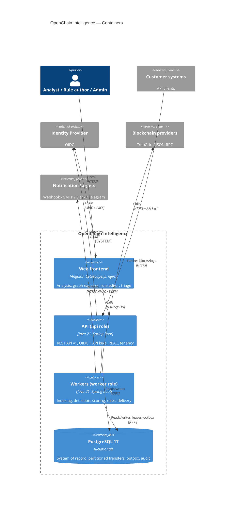

# C4 — Level 2: Containers

Source of truth: [`workspace.dsl`](workspace.dsl).

## Notes

- `api` and `worker` are the **same image**; the MVP runs both in one process. Role selection by `OCI_ROLES` (`api`, `worker`, `api,worker`) is planned and not implemented yet.
- Workers coordinate only through PostgreSQL (checkpoints, `FOR UPDATE SKIP LOCKED` leases, outbox). Any number of worker replicas can run; one indexer lease per network is held at a time.
- Optional containers (not shown): OpenTelemetry Collector, Prometheus, Grafana (`observability` profile); later Kafka, ClickHouse, Valkey.
