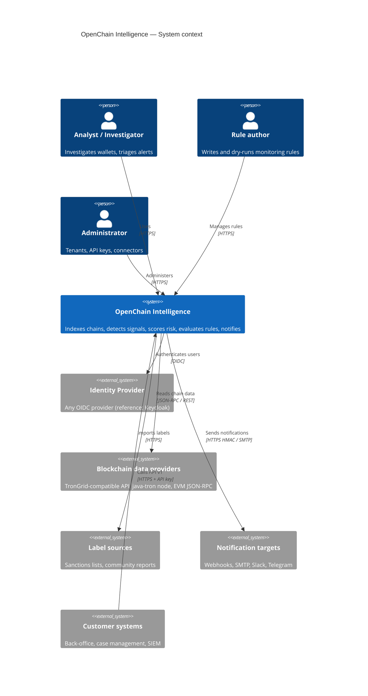

# C4 — Level 1: System context

Source of truth: [`workspace.dsl`](workspace.dsl) (render with Structurizr Lite: `docker run -it --rm -p 8081:8080 -v $PWD/docs/architecture/c4:/usr/local/structurizr structurizr/lite`). The Mermaid version below is kept in sync by hand.

## Responsibilities at the boundary

| External system | Trust | Notes |
|---|---|---|
| Identity Provider | Trusted for identity only | Roles mapped from token claims; tenant from a dedicated claim. |
| Blockchain providers | **Untrusted data**, unreliable availability | Responses validated (hash linkage, number parsing); failover across providers. |
| Label sources | Attributed, not authoritative unless official | Each label stores `source`, `evidence_level`, `licence`. |
| Notification targets | Untrusted network destinations | SSRF guard, timeouts, HMAC signatures. |
| Customer systems | Authenticated via API keys with scopes | Rate limited per key and tenant. |
