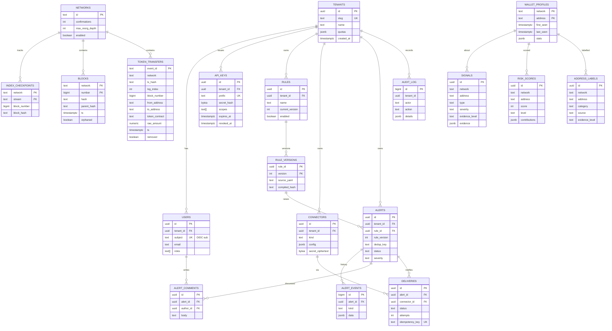

# Data model (PostgreSQL 17)

Conventions:

- Primary keys: `uuid` (UUIDv7, time-ordered) for tenant-owned entities; natural keys for chain data (`event_id`, `(network, number)`).
- Amounts: `numeric(78,0)` for raw integer units (fits `uint256`), `numeric(78,18)` only for derived human amounts. Never `float`/`double`.
- Addresses: `text` in canonical form (EVM lowercase hex, TRON base58) + `network text`.
- Time: `timestamptz`, UTC.
- Tenant-owned tables carry `tenant_id uuid not null` and have Row-Level Security (`USING (tenant_id = current_setting('app.tenant_id')::uuid)`).
- Migrations: Flyway (`oci-app/src/main/resources/db/migration`). The DDL below is the reference design; migrations are authoritative.

## Implemented schema (V1 operator state, V2 freeze backfill, V3 alert subject, V4 address history, V5 rule actions override, V6 skipped deliveries, V7 watchlist, V8 indexer checkpoints)

`V1__operator_state.sql` implements the **operator state**; `V2__freeze_backfill.sql` adds the freeze backfill tables; `V3__alert_subject.sql` stores what each alert is about; `V4__address_history.sql` adds the on-demand address history tables (ADR-0020); `V5__rule_actions_override.sql` adds `rules.actions_override` (operator's notification routing kept across rule pack updates); `V6__delivery_skipped.sql` allows the delivery status `SKIPPED` (no connector could receive the notification); `V7__watchlist.sql` stores the organisation's own wallets (unique per network and address); `V8__indexer_checkpoints.sql` stores the last processed block of each real chain and the block references of its reorg window. It differs from the reference design below:

| Area | Implemented (V1) | Reference design |
|---|---|---|
| Tenancy | single tenant: no `tenants` table, no `tenant_id`, no RLS | `tenant_id` + RLS everywhere |
| Identifiers | `text` (application UUIDs, rule slugs, `wh-…` connector ids) | `uuid` (UUIDv7) |
| `users` | `id`, `email`, `name`, one `role` (check: VIEWER/ANALYST/RULE_AUTHOR/ADMIN), `last_login_at` | OIDC `issuer`/`subject`, `roles text[]` |
| `api_keys` | as designed (prefix + `secret_hash`, expiry, revocation, `last_used_at`) with `env`, `scopes jsonb`, `created_by text` | `scopes text[]`, `created_by` FK |
| `connectors` | `type`, `name`, `events jsonb`, `target_masked`; target and WEBHOOK secret AES-256-GCM encrypted in separate columns (`enc_key_id`, `target_nonce`/`target_ciphertext`, `secret_nonce`/`secret_ciphertext`) | `config jsonb` + one `secret_ciphertext` |
| `rules` / `rule_versions` | rule id = rule slug; `origin` (repository/api), soft delete `deleted_at`, `row_version`; versions keep the source as submitted (`source` + `format` YAML/JSON), `compiled_hash` (sha256 of the source), `rule_semver` | `name` unique per tenant, `source_yaml`, `schema_version` |
| `alerts` | full alert snapshot: engine lifecycle statuses (DETECTED…FALSE_POSITIVE), priority, escalation, `matched_event_ids jsonb` (GIN index), `evidence jsonb` (typed JSON keeping exact decimals), `origin_chain`, `hop`, `row_version` (optimistic locking); since V3 the **subject** of the (latest) triggering event: `subject_event_id`, `subject_event_type`, `subject_address` (indexed), `subject_counterparty`, `subject_tx_hash`, `subject_block`, `subject_time`, `subject_fields jsonb` (typed JSON snapshot of the enriched event fields), so wallet / transaction / matched event survive a restart | `OPEN/…/RETRACTED`, `explanation`, `event_ids text[]`, `subject_address` |
| History / comments | `alert_history` (status changes and annotations, append-only) and `alert_comments` (`author text`), keyed `(alert_id, seq)` | `alert_events` (kind + jsonb), `alert_comments.author_id` FK |
| `deliveries` | outbox with `notification jsonb` snapshot, statuses PENDING/DELIVERED/DEAD_LETTER, `next_attempt_at`, claim lease (`claimed_by`, `claimed_until`, `FOR UPDATE SKIP LOCKED`); the delivery `id` is the receivers' idempotency key; no FK to `connectors` (built-in connectors are not rows) | `idempotency_key`, `payload`, RETRY/FAILED/DEAD |
| `label_reports` | community reports in moderation (added) | not in the design |
| `backfill_progress` / `backfill_freeze_events` (V2) | freeze backfill progress (`id` = `freezes:<network>`, `from_block`, `last_scanned_block`, `freezes_found`) and the issuer freeze/unfreeze events it found (PK `(backfill_id, event_id)`, `event_id` = `network:txHash:logIndex`; `target`, `token_contract`, `issuer`, `action` FREEZE/UNFREEZE, `event_name`, `block_number`, `block_time`); re-applied at startup without RPC | not in the design |
| `address_history_progress` / `address_history_events` (V4) | on-demand address history (ADR-0020): one progress row per (network, address) (`id` = `history:<network>:<address>`, `source`, `status` PENDING/RUNNING/COMPLETE/TRUNCATED/FAILED, target range `from_block`..`to_block`, `covered_from_block` / `covered_from_time`, resume `cursor`, `events_found`, `pages`, `truncated`, `last_error`) and the events found (PK `(history_id, event_id)`, `event_type`, `block_number` (-1 when the source has none), `block_hash`, `event_time`, `fields jsonb`); re-applied at startup without RPC, unfinished backfills resume from the cursor | not in the design |
| Not implemented yet | `tenants`, `audit_log` (audit is the `oci.audit` log stream), all chain-data and intelligence tables (`networks`, `index_checkpoints`, `blocks`, `token_transfers`, `address_edges`, `wallet_profiles`, `address_labels`, `signals`, `risk_scores`) | |

Chain-derived state (except indexer checkpoints, V8) stays in memory and starts empty at restart; alert
creation is idempotent on replayed events. TODO(persistence): chain-data tables, `audit_log`, tenancy.

### Chain events (in memory, `ChainEvent`)

| Type | Event id | Main fields |
|---|---|---|
| `TOKEN_TRANSFER` | `network:txHash:logIndex` | `transaction.{hash,log_index,from,to,amount,amount_raw,token.*}` |
| `NATIVE_TRANSFER` | `network:txHash:native` | same `transaction.*` (no `token.contract`) + `transaction.{fee,success,method,contract_interaction}` |
| `APPROVAL` | `network:txHash:logIndex` | `approval.{owner,spender,amount,amount_raw,unlimited}`, `token.{symbol,contract}` (+ `approval.{spender_is_contract,spender_age_days}` from enrichment) |
| `CONTRACT_ADMIN_CHANGE` | `network:txHash:logIndex` | `admin.{contract,previous,new,role,renounced}` (role `owner` / `implementation` / `proxy-admin`; no `previous` for `Upgraded`), `contract.{address,event,new_owner}`, `token.*` for registry tokens |
| `STABLECOIN_FREEZE` / `STABLECOIN_UNFREEZE` | `network:txHash:logIndex` | `freeze.{address,token,token_contract,action,issuer,event}` (+ `freeze.known_counterparties` from enrichment) |
| `DETECTION_SIGNAL` | `signal:<id>` | `signal.{type,severity,confidence,evidence_level}` |

All carry `network`, `block.{number,hash,timestamp}`. Label category `ISSUER_FROZEN` (source `tether-onchain` /
`circle-onchain`, reliability 1.0, CONFIRMED_BY_SOURCE, reference = freeze tx hash, observedAt = block time) is
created by a freeze and removed by the matching unfreeze; scoring weight 0.60, non-decaying while active.

## ER diagram



## Table definitions

### Tenancy and identity

```sql
create table tenants (
  id          uuid primary key,
  slug        text not null unique check (slug ~ '^[a-z0-9-]{3,40}$'),
  name        text not null,
  quotas      jsonb not null default '{}',   -- rules, connectors, api rate, dry-run budget
  created_at  timestamptz not null default now()
);

create table users (
  id          uuid primary key,
  tenant_id   uuid not null references tenants(id),
  subject     text not null,                  -- OIDC "sub"
  issuer      text not null,
  email       text,
  roles       text[] not null default '{VIEWER}',
  created_at  timestamptz not null default now(),
  last_login  timestamptz,
  unique (issuer, subject)
);

create table api_keys (
  id           uuid primary key,
  tenant_id    uuid not null references tenants(id),
  name         text not null,
  prefix       text not null unique,          -- public lookup part, e.g. "oci_live_7Hq2"
  secret_hash  bytea not null,                -- HMAC-SHA256(pepper, secret) — never the secret
  scopes       text[] not null,
  created_by   uuid references users(id),
  created_at   timestamptz not null default now(),
  last_used_at timestamptz,
  expires_at   timestamptz,
  revoked_at   timestamptz
);
```

### Chain data (shared, not tenant-scoped)

```sql
create table networks (
  id               text primary key,          -- 'tron', 'ethereum', ...
  confirmations    int  not null,
  max_reorg_depth  int  not null,
  enabled          boolean not null default false,
  config           jsonb not null default '{}'  -- tracked token contracts, provider order
);

create table index_checkpoints (
  network       text not null references networks(id),
  stream        text not null,                 -- 'transfers', 'blocks'
  block_number  bigint not null,
  block_hash    text not null,
  updated_at    timestamptz not null default now(),
  lease_owner   text,
  lease_until   timestamptz,
  primary key (network, stream)
);

-- Recent window only (>= max_reorg_depth, default 10 000 blocks), used for reorg detection.
create table blocks (
  network      text not null,
  number       bigint not null,
  hash         text not null,
  parent_hash  text not null,
  ts           timestamptz not null,
  orphaned     boolean not null default false,
  primary key (network, number)
);

create table token_transfers (
  event_id        text not null,              -- network:txHash:logIndex
  network         text not null,
  tx_hash         text not null,
  log_index       int  not null,
  block_number    bigint not null,
  block_hash      text not null,
  ts              timestamptz not null,
  from_address    text not null,
  to_address      text not null,
  token_contract  text,                       -- null = native coin
  token_symbol    text,
  token_decimals  smallint not null,
  raw_amount      numeric(78,0) not null check (raw_amount >= 0),
  removed         boolean not null default false,
  ingested_at     timestamptz not null default now(),
  primary key (event_id, ts)
) partition by range (ts);
-- monthly partitions: token_transfers_2026_11 ... created ahead by a scheduled job

create index on token_transfers (network, from_address, ts desc);
create index on token_transfers (network, to_address, ts desc);
create index on token_transfers (network, tx_hash);
create index on token_transfers using brin (block_number);

-- Materialised adjacency for graph queries (aggregated edges)
create table address_edges (
  network         text not null,
  from_address    text not null,
  to_address      text not null,
  token_contract  text not null default '',
  tx_count        bigint not null,
  total_raw       numeric(78,0) not null,
  first_ts        timestamptz not null,
  last_ts         timestamptz not null,
  primary key (network, from_address, to_address, token_contract)
);
create index on address_edges (network, to_address);
```

### Freeze backfill (implemented, V2)

```sql
create table backfill_progress (
  id                  text primary key,           -- freezes:<network>
  network             text not null,
  from_block          bigint not null check (from_block >= 0),
  last_scanned_block  bigint not null,            -- [from_block, last_scanned_block] fully scanned
  freezes_found       bigint not null default 0,
  updated_at          timestamptz not null
);
create table backfill_freeze_events (
  backfill_id text not null references backfill_progress (id),
  event_id text not null,                         -- network:txHash:logIndex (same id as live indexing)
  network text not null, tx_hash text not null, log_index int not null,
  block_number bigint not null, block_hash text, block_time timestamptz not null,
  target text not null, token_contract text not null, issuer text not null,
  action text not null check (action in ('FREEZE', 'UNFREEZE')), event_name text not null,
  primary key (backfill_id, event_id)
);
```

A chunk's events and the new progress are written in one transaction before the events are applied; inserts are
`on conflict do nothing`, so rescans are idempotent.

### Alert subject (implemented, V3)

```sql
alter table alerts
  add column subject_event_id text, add column subject_event_type text,
  add column subject_address text, add column subject_counterparty text, add column subject_tx_hash text,
  add column subject_block bigint, add column subject_time timestamptz,
  add column subject_fields jsonb;                -- TypedJson snapshot of the triggering event fields
create index alerts_subject_address on alerts (subject_address);
```

Written at alert creation and refreshed from the latest trigger when an occurrence is grouped. Back-fill of rows created
before V3: the migration sets `subject_address` only where it is unambiguous (aggregation / sequence alerts whose first
grouping field is `transaction.from` / `wallet.address`, read from `group_key`); the application fills the whole subject
when the triggering event is replayed by re-indexing (`AlertService.onMatch`); otherwise the subject stays null.

### Address history (implemented, V4)

```sql
create table address_history_progress (
  id text primary key,                            -- history:<network>:<address>
  network text not null, address text not null, source text not null,   -- eth_getLogs, trongrid
  status text not null check (status in ('PENDING', 'RUNNING', 'COMPLETE', 'TRUNCATED', 'FAILED')),
  from_block bigint not null, to_block bigint not null,                 -- target range (lookback .. first live block - 1)
  covered_from_block bigint, covered_from_time timestamptz,            -- [covered_from_block, to_block] fully loaded
  cursor text, events_found bigint not null default 0, pages int not null default 0,
  truncated boolean not null default false, last_error text,
  created_at timestamptz not null, updated_at timestamptz not null
);
create table address_history_events (
  history_id text not null references address_history_progress (id),
  event_id text not null,                         -- live indexer id when the source exposes it
  event_type text not null, block_number bigint not null, block_hash text, event_time timestamptz not null,
  fields jsonb not null,
  primary key (history_id, event_id)
);
create index address_history_events_order on address_history_events (history_id, event_time, event_id);
```

Each page's events and the progress are written in one transaction; when the backfill ends (COMPLETE / TRUNCATED) the
stored events are applied to the intelligence pipeline in chronological order, without rule evaluation.

### Intelligence

```sql
create table wallet_profiles (
  network      text not null,
  address      text not null,
  first_seen   timestamptz,
  last_seen    timestamptz,
  tx_count     bigint not null default 0,
  stats        jsonb not null default '{}',   -- baselines: median amount, active hours, counterparties
  is_contract  boolean,
  refreshed_at timestamptz,
  primary key (network, address)
);

create table address_labels (
  id              uuid primary key,
  network         text not null,
  address         text not null,
  category        text not null,              -- EXCHANGE, SANCTIONED, MIXER, ISSUER_FROZEN, ...
  name            text,
  source          text not null,              -- 'ofac-sdn', 'community-report', ...
  source_ref      text,                       -- URL / list entry id
  licence         text,
  evidence_level  text not null check (evidence_level in ('ANOMALY','RISK_SIGNAL','CONFIRMED_BY_SOURCE')),
  status          text not null default 'ACTIVE', -- ACTIVE, DISPUTED, WITHDRAWN
  tenant_id       uuid,                       -- null = global; set = private tenant label
  valid_from      timestamptz not null default now(),
  valid_to        timestamptz
);
create index on address_labels (network, address) where status = 'ACTIVE';

create table signals (
  id              uuid primary key,
  network         text not null,
  address         text not null,
  tx_hash         text,
  type            text not null,
  severity        text not null,
  confidence      numeric(4,3) not null check (confidence between 0 and 1),
  evidence_level  text not null,
  evidence        jsonb not null,             -- [{kind, description, reference, source, observedAt}]
  detector_id     text not null,              -- 'fast-forward@1'
  detected_at     timestamptz not null,
  retracted_at    timestamptz                 -- set on reorg
);
create index on signals (network, address, detected_at desc);

create table risk_scores (                   -- append-only history
  id             uuid primary key,
  network        text not null,
  address        text not null,
  score          smallint not null check (score between 0 and 100),
  level          text not null,
  contributions  jsonb not null,              -- RiskScore.Contribution[]
  method         text not null,
  model_version  text not null,
  computed_at    timestamptz not null
);
create index on risk_scores (network, address, computed_at desc);
```

### Rules and alerts (tenant-scoped)

```sql
create table rules (
  id               uuid primary key,
  tenant_id        uuid not null references tenants(id),
  name             text not null,
  description      text,
  current_version  int not null,
  enabled          boolean not null default false,
  created_by       uuid references users(id),
  created_at       timestamptz not null default now(),
  updated_at       timestamptz not null default now(),
  row_version      bigint not null default 0,  -- optimistic locking (ETag / If-Match)
  unique (tenant_id, name)
);

create table rule_versions (                 -- immutable
  rule_id         uuid not null references rules(id),
  version         int not null,
  schema_version  text not null,              -- 'openchain.io/rule/v1'
  source_yaml     text not null check (length(source_yaml) <= 65536),
  compiled_hash   text not null,              -- sha256 of canonical compiled form
  created_by      uuid references users(id),
  created_at      timestamptz not null default now(),
  primary key (rule_id, version)
);

create table alerts (
  id               uuid primary key,
  tenant_id        uuid not null references tenants(id),
  rule_id          uuid not null references rules(id),
  rule_version     int not null,
  dedup_key        text not null,
  status           text not null,             -- OPEN, ACKNOWLEDGED, IN_PROGRESS, RESOLVED, FALSE_POSITIVE, RETRACTED
  severity         text not null,
  title            text not null,
  network          text not null,
  subject_address  text,
  window_start     timestamptz,
  window_end       timestamptz,
  explanation      jsonb not null,            -- conditions evaluated, values, thresholds
  event_ids        text[] not null,           -- contributing events (capped, rest in alert_events)
  provisional      boolean not null default false,
  assignee_id      uuid references users(id),
  occurrences      int not null default 1,
  last_notified_at timestamptz,
  created_at       timestamptz not null default now(),
  updated_at       timestamptz not null default now()
);
create unique index alerts_open_dedup on alerts (tenant_id, dedup_key)
  where status in ('OPEN','ACKNOWLEDGED','IN_PROGRESS');
create index on alerts (tenant_id, status, created_at desc);
create index on alerts (tenant_id, subject_address);

create table alert_events (                  -- append-only history
  id         bigserial primary key,
  alert_id   uuid not null references alerts(id),
  tenant_id  uuid not null,
  kind       text not null,                   -- OPENED, OCCURRENCE_ADDED, STATUS_CHANGED, ASSIGNED, RETRACTED, DELIVERY_FAILED
  actor      text,
  data       jsonb not null default '{}',
  at         timestamptz not null default now()
);
create index on alert_events (alert_id, at);

create table alert_comments (
  id         uuid primary key,
  alert_id   uuid not null references alerts(id),
  tenant_id  uuid not null,
  author_id  uuid not null references users(id),
  body       text not null check (length(body) <= 10000),
  created_at timestamptz not null default now()
);

create table connectors (
  id                 uuid primary key,
  tenant_id          uuid not null references tenants(id),
  kind               text not null,           -- WEBHOOK, EMAIL, SLACK, TELEGRAM
  name               text not null,
  config             jsonb not null,          -- url, headers allow-list, recipients (no secrets)
  secret_ciphertext  bytea,                   -- AES-256-GCM(secret), nonce prefixed
  secret_key_id      text,                    -- encryption key id for rotation
  enabled            boolean not null default true,
  created_at         timestamptz not null default now()
);

create table deliveries (                    -- transactional outbox
  id                uuid primary key,
  tenant_id         uuid not null,
  alert_id          uuid references alerts(id),
  connector_id      uuid not null references connectors(id),
  idempotency_key   text not null unique,    -- alertId:connectorId:eventSeq
  payload           jsonb not null,
  status            text not null,           -- PENDING, RETRY, DELIVERED, FAILED, DEAD
  attempts          int not null default 0,
  next_attempt_at   timestamptz not null default now(),
  last_status_code  int,
  last_error        text,
  created_at        timestamptz not null default now(),
  delivered_at      timestamptz
);
create index deliveries_due on deliveries (next_attempt_at) where status in ('PENDING','RETRY');

create table audit_log (                     -- append-only; UPDATE/DELETE revoked from app role
  id          bigserial primary key,
  tenant_id   uuid,
  actor       text not null,                  -- user id or api key prefix
  actor_type  text not null,                  -- USER, API_KEY, SYSTEM
  action      text not null,                  -- RULE_UPDATED, API_KEY_CREATED, ...
  target      text,
  ip          inet,
  user_agent  text,
  details     jsonb not null default '{}',
  prev_hash   bytea,                          -- hash chain for tamper evidence
  at          timestamptz not null default now()
);
create index on audit_log (tenant_id, at desc);
```

## Retention

| Table | Default retention | Mechanism |
|---|---|---|
| `blocks` | last `max(max_reorg_depth, 10 000)` blocks per network | scheduled delete |
| `token_transfers` | 13 months (configurable) | drop monthly partitions |
| `address_edges` | rebuilt from transfers; follows transfer retention | incremental upsert + periodic compaction |
| `signals` | 24 months | delete by `detected_at` |
| `risk_scores` | latest per address forever, history 24 months | delete older than N except latest |
| `alerts`, `alert_events`, `alert_comments` | 5 years (compliance) | tenant-configurable |
| `deliveries` | 30 days after terminal status | scheduled delete |
| `audit_log` | 5 years | partition by year, never updated |

Personal data: `users.email` and comments may contain personal data; tenant deletion cascades to all tenant-scoped rows. Chain data is public and not personal data per se, but labels attached to addresses are treated as sensitive and always carry their source.
