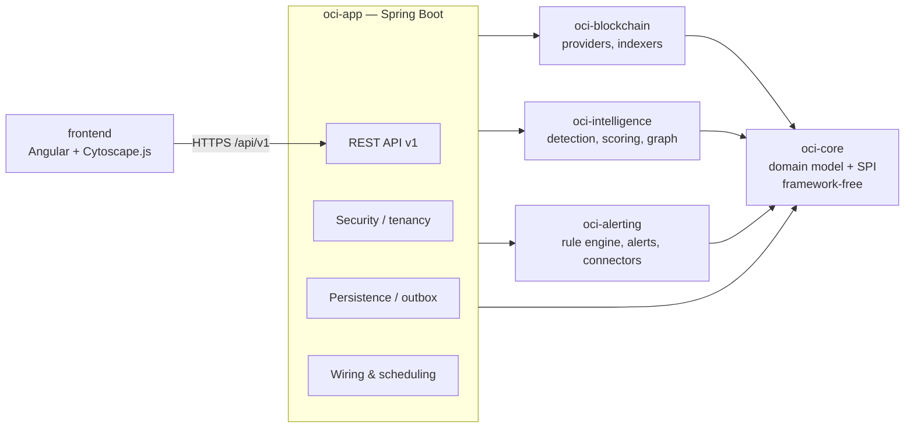
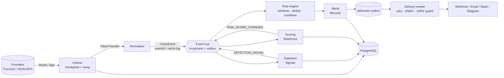

# OpenChain Intelligence — Technical Architecture

> Status: **proposal v0.1** (matches the 0.1.0 MVP). Decisions referenced here are recorded as ADRs in [`docs/adr/`](../adr/).

## 1. Context

OpenChain Intelligence (OCI) is an open source (Apache-2.0) platform for:

- **Blockchain investigation** — analyse a wallet or a transaction, explore its counterparty graph, understand where funds came from and went to.
- **Risk intelligence** — produce *explainable* risk scores and signals from on-chain behaviour and from external, attributed sources (sanctions lists, community reports).
- **Programmable monitoring** — let users declare monitoring rules (YAML/JSON, no code execution) that raise alerts and notify external systems (webhooks, email, chat).

Typical users: compliance analysts in exchanges/PSPs, security teams of protocols, investigators, researchers and journalists. Primary chains in the MVP: **TRON** (USDT-TRC20 is the dominant stablecoin rail) and **EVM chains** (Ethereum, BSC, Polygon).

### What makes this domain hard

| Concern | Consequence for the design |
|---|---|
| Chains reorganise | Every derived fact (signal, alert, score) must be retractable; confirmations are first-class. |
| Providers are unreliable and rate limited | A provider SPI with failover, budgets and circuit breakers; indexing is resumable from checkpoints. |
| Amounts have 6–18 decimals | `BigInteger` raw units end to end, `BigDecimal` for human amounts, never `double` for money. |
| Risk labels have legal impact | Signals carry an evidence level (`ANOMALY`, `RISK_SIGNAL`, `CONFIRMED_BY_SOURCE`); the platform never labels an address as "criminal". |
| Users write rules | Rules are declarative data compiled to a closed set of operators. No scripting, no SpEL, no reflection. |

## 2. Goals and non-goals

### Goals

1. A single deployable that a small team can run with `docker compose up` on one machine.
2. Multi-chain by construction: business logic depends on the `BlockchainProvider` SPI and on the canonical `ChainEvent`, never on a chain SDK.
3. Explainability: every score point and every alert can be traced to evidence (tx hash, rule version, source, timestamp).
4. Correctness under reorgs, duplicates and provider failures (idempotent, deterministic event ids).
5. Safe extensibility: new detectors, new connectors and new chains are added as code by contributors; new *rules* are added as data by users.
6. Clean path to scale: Kafka, ClickHouse, a dedicated graph store and Kubernetes can be introduced without rewriting the domain.

### Non-goals (for 0.x)

- Not a full archival block explorer; only a **recent block window** and token transfers are stored.
- No attribution/clustering of real-world identities; labels come from attributed sources only.
- No automated enforcement (freezing, blocking). OCI informs humans and systems; decisions stay with them.
- No user-defined code (scripts, WASM, plugins uploaded at runtime).
- No custody, no private keys, no transaction signing.
- No guarantee of sub-second alerting latency; the target is "seconds after confirmation".

## 3. Architectural style: modular monolith + workers

OCI is a **modular monolith** ([ADR-0001](../adr/0001-modular-monolith-and-workers.md)): one Spring Boot codebase, several Maven modules with enforced dependency direction, deployable in two **roles** from the same image:

- `api` role — REST API v1, authentication, investigation queries.
- `worker` role — indexers, detection, scoring, rule evaluation, notification delivery.

In the MVP both roles run in the same JVM; operator state (keys, connectors, rules, alerts, outbox) is in PostgreSQL when configured, chain-derived state in memory. Target design: roles selected by `OCI_ROLES` (not implemented yet) and workers coordinating through PostgreSQL (checkpoints, `SELECT … FOR UPDATE SKIP LOCKED` leases, outbox) instead of in-memory state, so that splitting them becomes a configuration change.

Why not microservices: the team is small, the domain boundaries are still moving, and the hardest problems (reorg consistency, idempotency) are much easier inside one transactional database. The module boundaries give us the *option* to extract services later along the same seams.

## 4. Module map

| Module | Responsibility | Depends on | Must NOT depend on |
|---|---|---|---|
| `oci-core` | Framework-free domain: `Network`, `Address`, `Token`, `TokenTransfer`, `ChainTransaction`, `BlockRef`, `Balance`, `NetworkStatus`, `Page`, `ChainEvent`, `Signal`, `RiskScore`, and the `BlockchainProvider` SPI. | JDK only | anything |
| `oci-blockchain` | `BlockchainProvider` adapters (TronGrid-compatible HTTP, EVM JSON-RPC), provider registry with failover, rate limiting, indexer, confirmation and reorg tracking, normalisation to `ChainEvent`. | `oci-core` | intelligence, alerting |
| `oci-intelligence` | Detectors producing `Signal`s (patterns, exposure), explainable risk scoring (`RiskScore`), graph exposure analysis. | `oci-core` | blockchain, alerting |
| `oci-alerting` | Rule DSL schema v1, compiler, evaluator (windows, dedup, cooldown), alert lifecycle, connectors (webhook/HMAC, email, Slack/Telegram), delivery policy. | `oci-core` | blockchain, **intelligence** |
| `oci-app` | Spring Boot application: REST API v1, OIDC/API keys, RBAC, tenant isolation, persistence (PostgreSQL, Flyway), outbox, scheduling, observability, demo mode. | all | — |
| `frontend` | Angular SPA: wallet/tx analysis, graph explorer (Cytoscape.js), rules editor with dry-run, alert triage. | API v1 only | — |

`oci-alerting` deliberately does not depend on `oci-intelligence`: it consumes `ChainEvent`s, including `RISK_SCORE_CHANGED` and `DETECTION_SIGNAL` events that intelligence publishes. Rules can therefore reference `wallet.risk_score` without a compile-time coupling.

## 5. Data flow

1. **Indexer** polls (or subscribes to) new heads, reads the block's activity (`BlockchainProvider.getBlockActivity`: native transfers of successful transactions, ERC-20/TRC-20 `Transfer` and `Approval` logs, issuer blacklist events of the official USDT/USDC contracts), persists it and advances an `index_checkpoint` atomically. Every kind shares the same confirmation, window and reorg-retraction mechanics.
2. **Normaliser** (`TransferEventMapper`) maps each item to a `ChainEvent` with a flat `fields` map: `TOKEN_TRANSFER` and `NATIVE_TRANSFER` (`transaction.amount`, `transaction.token.symbol`, `transaction.from`, …), `APPROVAL` (`approval.owner/spender/amount/unlimited`), `STABLECOIN_FREEZE` / `STABLECOIN_UNFREEZE` (`freeze.address/token/action/issuer/event`). Event ids are deterministic: `network:txHash:logIndex` for logs, `network:txHash:native` for the native value of a transaction; they are the idempotency key everywhere downstream.
   - Native value: EVM transactions with `value > 0` and receipt `status = 0x1` (contract creations go to the created contract); TRON `TransferContract` / `TriggerSmartContract.call_value` with `ret[0].contractRet = SUCCESS`. **Internal transactions (traces) are not indexed.**
   - Approvals: registry tokens only unless `approvals-of-unknown-tokens` is set; they feed `UnusualApprovalDetector`.
   - Freezes: decoded only from the issuers' own contracts (`StablecoinFreezeSources`); the frozen address gets an `ISSUER_FROZEN` label (source `tether-onchain` / `circle-onchain`, CONFIRMED_BY_SOURCE, reference = tx hash), is rescored, and detection re-runs for its counterparties; an unfreeze removes the label and rescores. A freeze states what the issuer did, not why. Freezes before the start block are covered by the optional bounded freeze backfill (`FreezeBackfill`, `oci.chains.<network>.freeze-backfill.*`), which feeds the same label path without rule evaluation.
3. **Detection** runs stateless and windowed detectors (e.g. fast forwarding, structuring, dormant reactivation, exposure) and emits `Signal`s with evidence. Exposure is protected against griefing: transfers of unverified token contracts and unsolicited inbound transfers below a per-token dust threshold (10 USDT / 10 USDC by default) create no exposure, direct or indirect; when they are the only link to a listed address a `DUSTING` anomaly (score weight 0) explains them. Outbound transfers always count.
4. **Scoring** aggregates signals into a `RiskScore` (saturating aggregation with decay; see [ADR-0008](../adr/0008-explainable-risk-scoring.md)) and publishes `RISK_SCORE_CHANGED` when the band changes.
5. **Rule engine** evaluates compiled rules against events, maintains window state, deduplicates and applies cooldowns, then opens or updates **alerts**.
6. **Notifications** are written to a `deliveries` outbox in the same transaction as the alert, then delivered by a worker with retries, HMAC signatures and SSRF protection.

Every stage is **idempotent on `eventId`** and **reorg-aware**: an event with `removed=true` retracts derived window contributions and moves affected alerts to `RETRACTED` (see [rule-engine.md](rule-engine.md#reorg-retraction)).

## 6. Multi-chain abstraction

### 6.1 `BlockchainProvider` SPI

Defined in `oci-core` (`io.openchain.core.provider.BlockchainProvider`): `getBlock`, `getTransaction`, `getTransactionReceipt`, `getAddressTransactions` (cursor paging), `getTokenTransfers(fromBlock, toBlock)`, `getBlockActivity(fromBlock, toBlock)` (default: token transfers only), `getAddressBalance`, `subscribeToEvents`, `getNetworkStatus`. Implementations are thread-safe, have bounded timeouts and throw `ProviderException(retryable)`.

### 6.2 Failover and rate limits

- A **provider registry** holds an ordered list of providers per network (primary, secondaries). A `FailoverProvider` composite implements the same SPI.
- Each provider has a **token-bucket rate limiter** (e.g. TronGrid free tier ≈ requests/s budget configured per API key) and a **circuit breaker** (open after N consecutive retryable failures, half-open probe).
- Retryable errors (timeouts, HTTP 429, 5xx, JSON-RPC `-32005`) are retried with exponential backoff + jitter, honouring `Retry-After`. Non-retryable errors (4xx, malformed request) fail fast.
- Health is exposed through `getNetworkStatus()` and surfaced at `GET /api/v1/networks` and as Prometheus metrics (`oci_provider_requests_total`, `oci_provider_latency_seconds`, `oci_provider_circuit_state`).
- Providers can disagree on head height; the registry never moves a checkpoint backwards because a secondary is lagging.

### 6.3 Confirmations

`Network.defaultConfirmations()` (TRON 19, Ethereum 12, BSC 15, Polygon 128, overridable). Events are processed in two tiers:

- **tentative** (head) — shown in the UI with a "pending confirmations" badge; rule engine can opt in (`confirmations: 0`), alerts raised from tentative events are flagged `provisional`.
- **confirmed** (`head - confirmations`) — the default for rules and scoring.

### 6.4 Reorg handling

The indexer keeps the last `Network.maxReorgDepth()` `BlockRef`s (number, hash, parentHash). On each new block it checks `parentHash == stored(number-1).hash`. On mismatch it walks back to the common ancestor, emits `removed=true` copies of all events from orphaned blocks, deletes/marks their rows, rewinds the checkpoint and re-indexes the canonical branch. Because ids are deterministic, re-indexed events that also exist on the new branch are simply re-applied. A reorg deeper than `maxReorgDepth` raises an operational alert and stops the indexer for that network (manual intervention) rather than silently corrupting state.

## 7. Indexing strategy per chain

| Chain | MVP source | Method | Notes |
|---|---|---|---|
| TRON | TronGrid-compatible HTTP API (TronGrid, or a self-hosted `java-tron` node exposing the same `/wallet/*` and `/v1/*` endpoints) | `/wallet/getnowblock`, `/wallet/getblockbynum` (transactions + `contractRet`), `gettransactioninfobyblocknum` (fees, TRC20 `Transfer`/`Approval`, USDT `AddedBlackList`/`RemovedBlackList`) | TronGrid API keys are rate-limited; for production volume run an own `java-tron` FullNode (event plugin optional). Addresses canonical in base58. |
| Ethereum / BSC / Polygon | Any JSON-RPC endpoint (own node, or a commercial RPC) | `eth_blockNumber`, `eth_getBlockByNumber(n, true)`, `eth_getBlockReceipts(n)` (statuses + logs); fallback when unsupported: `eth_getLogs({blockHash})` + `eth_getTransactionReceipt` for value-carrying transactions | Adaptive range sizing (halve on "too many results"/timeouts). Addresses canonical lowercase hex. Polygon needs deep confirmations. |
| Bitcoin | *planned* | Bitcoin Core RPC / Esplora; UTXO model maps to multi-input/multi-output `ChainTransaction` | Requires UTXO-aware graph edges. |
| Solana | *planned* | JSON-RPC `getBlock` + SPL token balance deltas | Slot-based; "finalized" commitment instead of confirmations. |

We write our **own thin HTTP JSON-RPC adapters** instead of Web3j or vendor SDKs ([ADR-0003](../adr/0003-own-json-rpc-adapters.md)): we only need a dozen calls, we want full control over timeouts, batching, retries and exact number parsing, and we avoid heavy transitive dependencies.

Backfill vs. live: a wallet analysis request on an address with no indexed history triggers an **on-demand fetch** through `getAddressTransactions` (paged, bounded by tenant quota), cached in `token_transfers`. Live indexing only covers configured networks and token contracts (e.g. USDT, USDC) in the MVP.

## 8. Event architecture

- **MVP: in-process event bus** (synchronous dispatch per partition key = address, with bounded queues) + **transactional outbox** in PostgreSQL for anything that must survive a crash (deliveries, published domain events). See [ADR-0006](../adr/0006-event-bus-outbox-kafka-later.md).
- **Kafka-ready**: the outbox table has `topic`, `key`, `payload`, `headers`. Introducing Kafka (Apache-2.0) means adding a relay that publishes outbox rows; consumers already deduplicate on `eventId`. Partitioning key: `network:address` to keep per-wallet ordering.
- **Flink only when needed**: windows in the MVP are bounded (≤ 24 h by default, ≤ 7 d max) and their state fits in PostgreSQL/heap on one node. Flink (Apache-2.0) becomes relevant when windowed state exceeds a single node or when we need exactly-once, large-scale CEP across partitions.

## 9. Storage

| Store | Role | When |
|---|---|---|
| PostgreSQL 17 | System of record: tenants, rules, alerts, outbox, audit, recent blocks, token transfers (monthly partitions), signals, scores, labels, graph edges | **now** ([ADR-0004](../adr/0004-postgresql-first-clickhouse-later.md)) |
| ClickHouse (Apache-2.0) | Analytical store for long transfer history, aggregates, baselines | **later**, when transfer volume or analytical queries exceed what partitioned Postgres serves within SLO (indicatively > 1–2 B rows or p95 > 2 s on investigation queries) |
| Graph | MVP: adjacency (`token_transfers` + materialised `address_edges`) queried with recursive CTEs, depth ≤ 3 and fan-out caps | **now**; Neo4j Community (GPLv3), Memgraph (BSL) and Apache AGE (Apache-2.0) evaluated in [ADR-0005](../adr/0005-graph-store.md) |
| Redis / Valkey | Optional cache and distributed rate-limit buckets | **optional**; prefer Valkey (BSD-3) given Redis licence changes |

See [data-model.md](data-model.md) for tables, indexes and retention.

## 10. Security model

- **Authentication**: OIDC/OAuth2 resource server (any compliant IdP; Keycloak is the reference, Apache-2.0) for humans; **API keys** for machines (`oci_<prefix>_<secret>`, only an Argon2id/SHA-256-HMAC hash stored, prefix used for lookup, scopes and expiry). See [ADR-0010](../adr/0010-authentication-oidc-api-keys.md).
- **Authorisation**: RBAC roles `VIEWER`, `ANALYST`, `RULE_AUTHOR`, `ADMIN`, plus API-key scopes (`wallets:read`, `rules:write`, `alerts:write`, …).
- **Tenant isolation**: every tenant-owned row carries `tenant_id`; the repository layer always filters by the authenticated tenant, and PostgreSQL Row-Level Security (`app.tenant_id` session setting) is enabled as defence in depth. Chain data (blocks, transfers) is shared and tenant-agnostic; derived tenant data (rules, alerts, comments, connectors) is not.
- **Audit log**: append-only `audit_log` for security-relevant actions (login, key creation, rule change, alert status change, label report, connector change), with actor, IP, user-agent, before/after hash.
- **Outbound calls (SSRF)**: webhook URLs must be `https` (http only in demo mode), are resolved and checked against deny-lists (loopback, link-local, RFC1918, CGNAT, metadata `169.254.169.254`, IPv6 ULA) **at delivery time** (DNS-rebinding safe: connect to the vetted IP), no redirects followed, strict timeouts, response body size cap. See [ADR-0009](../adr/0009-webhook-security.md).
- **Webhook authenticity**: `X-OCI-Signature: t=<unix>,v1=<hex HMAC-SHA256(secret, t + "." + body)>`; replay window 5 min; secret rotation with two active secrets.
- **Secrets**: connector secrets encrypted at rest with AES-256-GCM (envelope encryption, key from env/KMS, `key_id` stored for rotation); never returned by the API after creation; never logged.
- **Input safety**: rule DSL is data validated against JSON Schema, compiled to a closed operator set, with complexity limits (see [rule-engine.md](rule-engine.md#safety-limits)); YAML parsed with a safe loader (no tags, no anchors bombs: alias/depth/size limits).
- **Transport and headers**: TLS terminated at the reverse proxy; CSP, HSTS, `X-Content-Type-Options`, CORS allow-list for the SPA.

## 11. Observability

- **OpenTelemetry** (Java agent or Micrometer tracing bridge) for traces: an event's `eventId` and `traceId` follow it from indexer to delivery.
- **Prometheus** scrapes `/actuator/prometheus`. Key metrics: indexer lag (`oci_indexer_lag_blocks{network}`), reorgs (`oci_reorg_total`, depth histogram), provider errors/latency, events processed, rule evaluations and latency, alerts opened, deliveries (success/failure/retry), outbox backlog.
- **Grafana** (AGPL-3.0, run as a separate service, not linked) dashboards provisioned from `deploy/grafana/`.
- **Logs**: structured JSON, no secrets, no full webhook payloads at INFO.
- **Health**: `/actuator/health` with liveness/readiness groups; readiness depends on DB, not on chain providers (a provider outage degrades, it does not kill the API).

## 12. Deployment strategy

1. **Docker Compose** (reference, single host): `postgres`, `app` (api+worker), `frontend` (nginx), optional `observability` profile (OTel Collector, Prometheus, Grafana). See [installation guide](../guides/installation.md).
2. **Kubernetes** (optional, later): same image, two Deployments (`api`, `worker`) selected by `OCI_ROLES`; managed PostgreSQL; HPA on the API; workers scale by network partition (lease per network). A Helm chart is planned, not shipped in 0.1.

## 13. Risks and dependencies register

| # | Risk / dependency | Likelihood | Impact | Mitigation |
|---|---|---|---|---|
| R1 | TronGrid / public RPC rate limits or ToS changes | High | High | Provider SPI, multiple providers, self-hosted `java-tron`/EVM node guide, request budgets. |
| R2 | Deep or frequent reorgs (Polygon) | Medium | High | Confirmation tiers, `maxReorgDepth`, retraction semantics, halt-on-overflow. |
| R3 | False positives harm innocent users | Medium | High | Evidence levels, wording policy ("signal", never "criminal"), explanations, human triage, label disputes. |
| R4 | Label/sanctions data licensing | Medium | Medium | Only sources with compatible terms; `source` + `licence` per label; OFAC SDN (public domain) as reference. |
| R5 | Postgres hot partitions / volume growth | Medium | Medium | Monthly partitions, retention, ClickHouse migration path. |
| R6 | Graph queries explode on hub addresses (exchanges) | High | Medium | Depth ≤ 3, fan-out caps, hub detection, query timeouts. |
| R7 | SSRF / webhook abuse | Medium | High | ADR-0009 controls, per-tenant connector quotas. |
| R8 | Rule DSL abused for DoS | Medium | Medium | Static complexity limits, evaluation budget, per-tenant rule quotas. |
| R9 | Licence contamination (AGPL/BSL/SSPL deps) | Low | High | Licence allowlist in CI ([ADR-0012](../adr/0012-licensing-policy.md)). |
| R10 | Spring Boot 4.x ecosystem maturity | Low | Medium | Pin versions, Dependabot, integration tests. |

## 14. Known limitations (0.1.0)

- Only fungible token transfers (TRC20/ERC20/BEP20) and native transfers are indexed; internal transactions (EVM traces) are not.
- In-process bus: a worker crash may lose in-flight *window state* not yet checkpointed; it is rebuilt by replaying recent transfers from PostgreSQL on start-up (bounded by the largest window).
- Graph exploration is limited to depth 3 and capped fan-out; results are a sample, flagged as truncated.
- Single-region, single-writer PostgreSQL; no HA in the Compose deployment.
- Price data (USD value) is optional and best-effort; rules on `amount_usd` are skipped when no price is available.
- Bitcoin and Solana providers are planned, not implemented.
- Demo mode (`OCI_DEMO_MODE=true`) uses a simulated chain; it must not be enabled in production (it relaxes webhook URL checks to allow `http://localhost` sinks).
