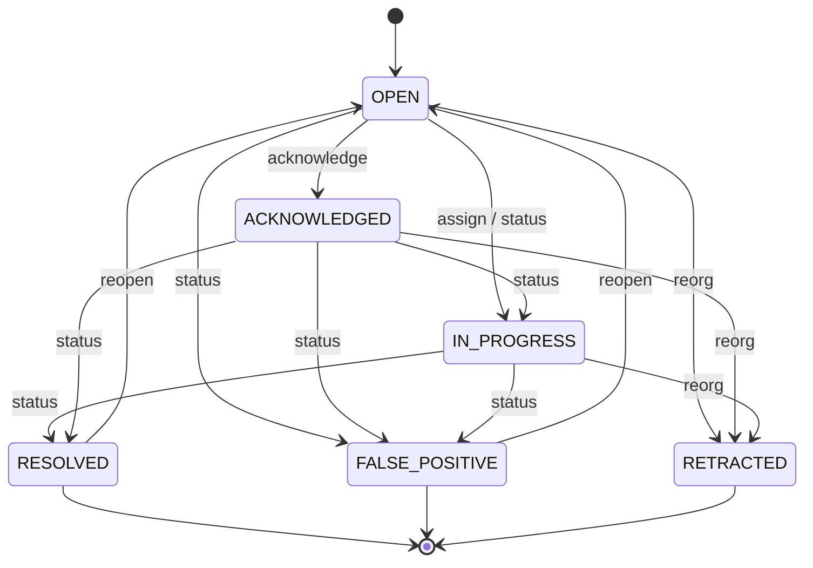

# Programmable alerting engine

Module: `oci-alerting` (depends only on `oci-core`). Decision record: [ADR-0007](../adr/0007-declarative-rule-dsl-no-scripting.md). User guide: [writing-rules.md](../guides/writing-rules.md).

## 1. Design principles

1. **Rules are data, not code.** A rule is a YAML/JSON document validated against schema `openchain.io/rule/v1` (`oci-alerting/src/main/resources/schema/rule-v1.schema.json`, enforced by `RuleValidator`) and compiled to a tree of a *closed* set of operators implemented in Java. Nothing in a rule is ever executed, evaluated as an expression language, or used for reflection.
2. **Deterministic and replayable.** Given the same event stream (by `eventTime`) a rule produces the same matches. This enables DRY_RUN and reorg retraction.
3. **Explainable.** Every alert stores which conditions held, with the observed values and thresholds, and the contributing `eventId`s.
4. **Bounded.** Static complexity limits at compile time, evaluation budgets at run time.

## 2. Schema v1

```yaml
apiVersion: openchain.io/rule/v1      # mandatory, exact
id: usdt-burst-outflow                # lowercase slug, unique
version: 1.0.0                        # semver; every PUT stores an immutable version
name: USDT burst outflow
description: Burst of large USDT outflows from one address
author: your-team
enabled: true
tags: [stablecoin, outflow]
scope:                                # empty / missing = any
  networks: [tron, ethereum]          # Network ids
  eventTypes: [TOKEN_TRANSFER]        # ChainEvent.EventType
conditions:                           # per-event filter: recursive group, logic AND | OR | NOT
  logic: AND
  rules:
    - field: transaction.token.symbol
      operator: IN
      value: [USDT]
    - field: transaction.amount
      operator: GREATER_THAN_OR_EQUAL
      value: "1000"                   # decimals as strings -> exact BigDecimal
aggregation:                          # optional: sliding event-time window (exclusive with sequence)
  window: 1h                          # 30s / 15m / 1h / 1d; between 1s and 7d
  groupBy: [transaction.from]         # 0..3 catalog fields
  function: SUM                       # COUNT | SUM | DISTINCT_COUNT | MAX | RATIO_OF_BALANCE
  field: transaction.amount
  operator: GREATER_THAN_OR_EQUAL     # GREATER_THAN | GREATER_THAN_OR_EQUAL
  threshold: "50000"
severity: HIGH                        # INFO | LOW | MEDIUM | HIGH | CRITICAL
evidenceLevel: ANOMALY                # ANOMALY | RISK_SIGNAL | CONFIRMED_BY_SOURCE (needs a source-backed field)
cooldown: 6h                          # matches with the same dedup key are grouped into one alert
dedupKey: "{{rule.id}}:{{group.key}}" # placeholders only: rule.id, rule.version, group.key, network, event.<field>
actions:                              # connector ids configured by an operator (rules never carry URLs)
  - type: WEBHOOK
    connectorId: ops-webhook
  - type: EMAIL
    connectorId: compliance-email
```

### Operators (closed set)

| Category | Operators |
|---|---|
| Comparison | `EQUALS`, `NOT_EQUALS`, `GREATER_THAN`, `GREATER_THAN_OR_EQUAL`, `LESS_THAN`, `LESS_THAN_OR_EQUAL`, `BETWEEN` |
| Sets | `IN`, `NOT_IN` (<= 1 000 literal values) |
| Strings | `CONTAINS`, `STARTS_WITH` (optional `ignoreCase`), `MATCHES` (bounded, ReDoS-safe regex) |
| Presence | `EXISTS` |
| Boolean groups | `logic: AND`, `OR`, `NOT` (NOT = exactly one child; max depth 5, max 50 conditions) |
| Aggregation | `COUNT`, `SUM`, `MAX`, `DISTINCT_COUNT`, `RATIO_OF_BALANCE` (one per rule) |
| Sequence | ordered steps sharing a key within a duration (`sequence:`, exclusive with `aggregation:`) |

Labels are matched through enriched string fields (`wallet.labels` / `counterparty.labels` with `CONTAINS`, e.g. `mixer`).
Named watchlists (`in_list`) and min/avg aggregates are not part of v1.

Fields are resolved from `ChainEvent.fields` by exact key lookup (`transaction.amount`, `transaction.from`, `transaction.to`, `transaction.token.symbol`, `transaction.token.contract`, `wallet.risk_score`, `wallet.labels`, `signal.type`, …). The allowed field catalogue is part of the schema; unknown fields are compile errors. Types are checked at compile time (a `BigDecimal` field only accepts numeric operators with decimal-string literals).

## 3. Compilation

```
YAML (safe loader: no tags, max 64 KiB, max depth 20, max aliases 0)
  → JSON tree → RuleValidator (schema openchain.io/rule/v1; errors with JSON paths, returned as JSON pointers by the API)
  → semantic checks (field catalogue, types, connectors exist, window ≤ 7d, limits)
  → CompiledRule (immutable): Predicate tree, WindowSpec, HavingSpec, DedupSpec, actions
  → compiled_hash = sha256(canonical JSON of the normalised rule)
```

`compiled_hash` lets us detect no-op updates, prove which exact logic produced an alert, and share rules across tenants. Each `PUT` creates a new immutable `rule_versions` row; alerts reference `(rule_id, rule_version)`.

## 4. Evaluation

Per incoming `ChainEvent`:

1. **Idempotency** — skip if `eventId` already applied for this rule version (bounded seen-set per window + DB unique constraints downstream).
2. **Routing** — index rules by `(network, eventType)`; only candidate rules are evaluated.
3. **Filter** — evaluate the `where` predicate (short-circuit, no allocation-heavy paths).
4. **Window** — if the rule has a window, add a *contribution* `(eventId, eventTime, values)` to the state for `(ruleVersion, groupKey)`; recompute incremental aggregates.
5. **Having** — evaluate aggregate conditions; produce a `RuleMatch` with the explanation.
6. **Dedup/cooldown** — hand to the deduplicator (section 6).

### Windows, watermarks and lateness

- Windows are in **event time** (`ChainEvent.eventTime` = block timestamp), never ingestion time.
- Per network, the **watermark** = `max(eventTime seen) − allowedLateness`. Contributions older than `watermark − size` are evicted.
- An event arriving with `eventTime < watermark − size` is **late**: it is counted in `oci_rule_late_events_total{rule}` and dropped. Late events never reopen expired windows (keeps evaluation deterministic and bounded).
- Sliding windows are implemented as a time-ordered deque of contributions with running aggregates (`sum`/`count` O(1); `min`/`max` via monotonic deques; `distinct_count` via a counting map). Tumbling windows align on UTC boundaries.
- Window state is checkpointed to PostgreSQL periodically; on restart, state is rebuilt by replaying `token_transfers` for `[now − maxWindow − lateness, now]`.

## 5. Reorg retraction

When an event arrives with `removed = true`:

1. Remove its contribution from every window that contains it (lookup by `eventId`), recompute aggregates.
2. For each **open** alert whose `event_ids` contains it, re-evaluate the `aggregation` threshold on the remaining contributions:
   - still satisfied → keep the alert, append `alert_events(OCCURRENCE_RETRACTED)`;
   - no longer satisfied → status `RETRACTED`, `alert_events(RETRACTED, reason=REORG)`, and a `alert.retracted` notification is queued to the same connectors.
3. Alerts in terminal human states (`RESOLVED`, `FALSE_POSITIVE`) are not modified; a history entry is added.

Rules with `confirmations: default` rarely see retractions; `confirmations: 0` rules produce `provisional` alerts that are expected to be retracted occasionally.

## 6. Deduplication and cooldown

- `dedupKey = sha256(tenantId, ruleId, values of dedup.key fields)` (rule *id*, not version: an edited rule keeps deduplicating).
- A partial unique index guarantees at most **one active alert per dedup key** (`OPEN`, `ACKNOWLEDGED`, `IN_PROGRESS`).
- Match with an active alert → `occurrences += 1`, new event ids appended; a notification is sent only if `now − last_notified_at ≥ cooldown`.
- No active alert → a new alert is opened and notifications are queued.
- Without `cooldown`, the engine still applies a minimum of 60 s to protect connectors.

## 7. Alert lifecycle



Every transition writes `alert_events` and `audit_log`. `FALSE_POSITIVE` feedback is exported (per rule) to help tune thresholds.

## 8. Connectors

| Kind | Transport | Security |
|---|---|---|
| `WEBHOOK` | HTTPS POST JSON | HMAC-SHA256 signature header, timestamp, SSRF guard, no redirects, 5 s timeout, 64 KiB max response read |
| `EMAIL` | SMTP (STARTTLS required) | recipients allow-listed per tenant, no HTML from rule content |
| `SLACK` | Incoming webhook URL | URL host must be `hooks.slack.com` |
| `TELEGRAM` | Bot API `sendMessage` | host fixed to `api.telegram.org`, token encrypted |

Delivery goes through the `deliveries` outbox: written in the same transaction as the alert, consumed by the delivery worker (`FOR UPDATE SKIP LOCKED`), retried with exponential backoff and jitter on 408/429/5xx/timeouts, `DEAD` after max attempts. Payloads contain the alert, explanation and links — never connector secrets. Rule text is never interpolated into templates as markup.

## 9. Safety limits

| Limit | Default | Where |
|---|---|---|
| Source size | 64 KiB | compile |
| Predicate nodes | 100 | compile |
| Boolean depth | 5 | compile |
| `in` literal values | 1 000 | compile |
| `groupBy` fields | 3 | compile |
| Window size | 7 d | compile |
| Active rules per tenant | 200 | API |
| Live groups per rule | 100 000 (oldest evicted, metric emitted) | runtime |
| Evaluation time budget per event, all rules of a tenant | 5 ms p99 target; rule disabled after repeated budget overrun, alert to admins | runtime |
| DRY_RUN range | ≤ 7 d, ≤ 100 000 events, 30 s wall clock | API |
| Connectors per rule | 5 | compile |

## 10. Why no scripting

Expression languages (SpEL, OGNL, MVEL, JEXL), embedded scripting (JavaScript/GraalJS, Groovy, Lua) and WASM plugins were rejected for user-authored rules:

- **Security**: these engines have a long history of sandbox escapes and RCE (e.g. SpEL/OGNL injection CVEs). A multi-tenant SaaS-style deployment cannot accept that class of risk.
- **Termination and cost**: arbitrary code cannot be statically bounded; our operators can.
- **Explainability**: a closed operator tree can be rendered back to a human explanation ("sum(amount) = 52 000 ≥ 50 000"); arbitrary code cannot.
- **Portability**: the declarative tree can later be translated to SQL (ClickHouse) or Flink jobs without re-interpreting user code.

New capabilities are added as **new operators or aggregates in Java**, reviewed through pull requests, and exposed through a new schema minor version.
