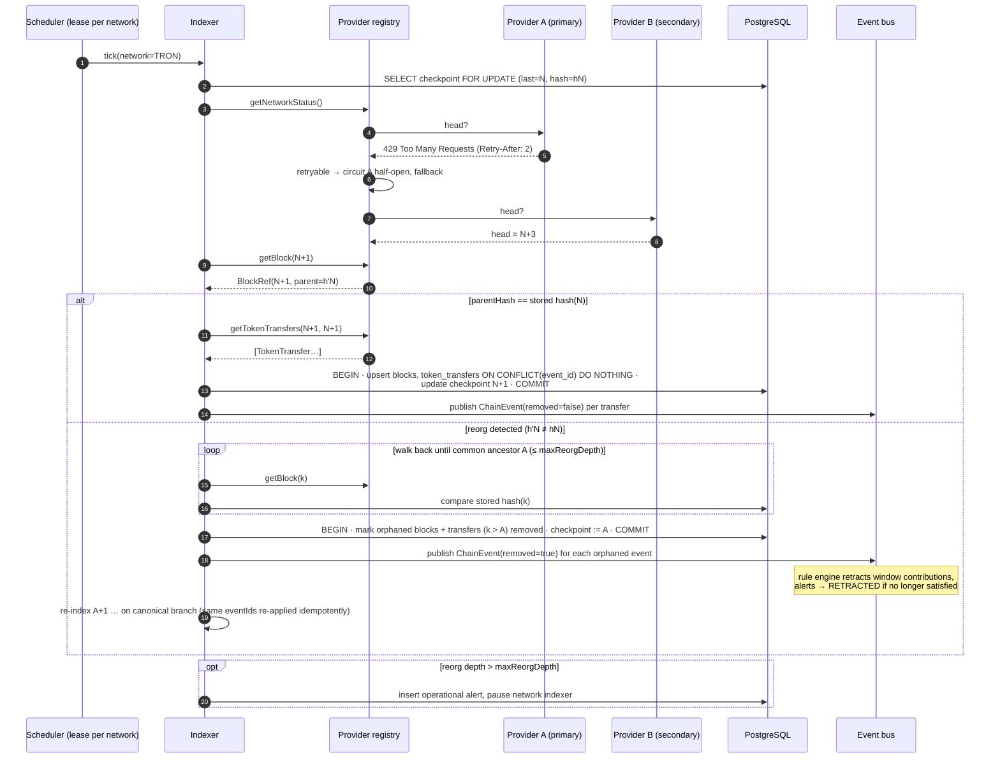
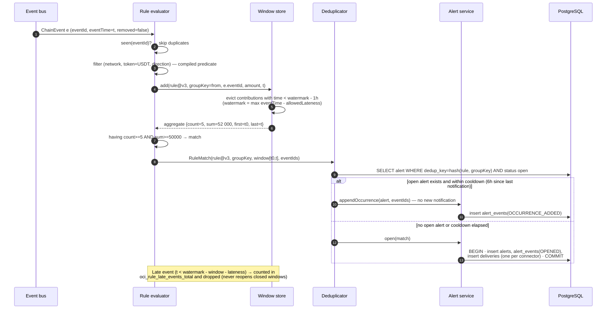
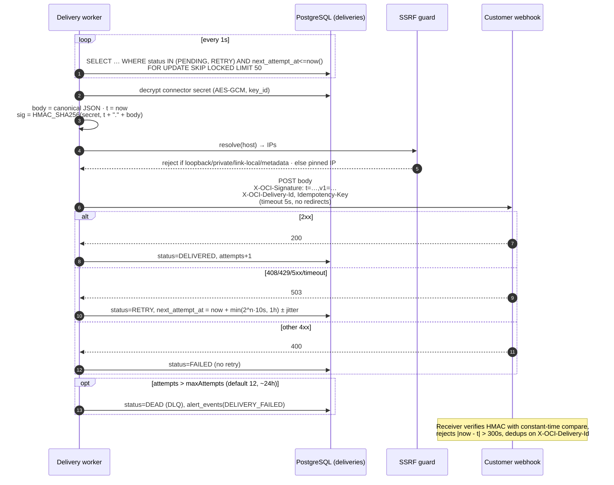
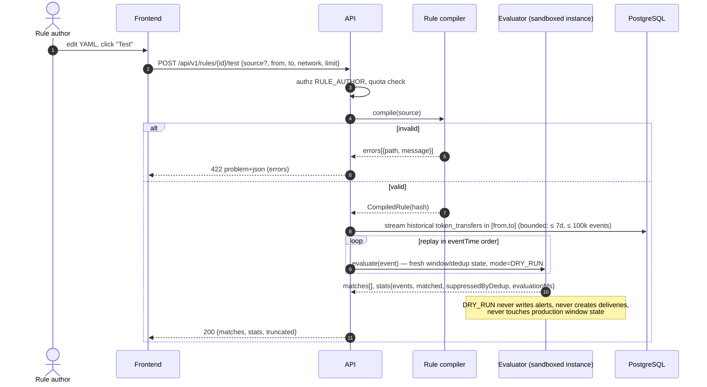
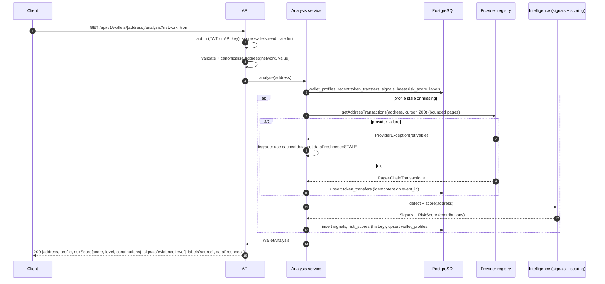

# Sequence diagrams

## 1. Indexing with reorg

## 2. Rule evaluation with sliding window, dedup and cooldown

Rule: *"≥ 5 outgoing USDT transfers totalling ≥ 50 000 within 1 h from the same address"*, dedup by `transaction.from`, cooldown 6 h.

## 3. Notification delivery with retry and HMAC

## 4. Rule test (DRY_RUN)

## 5. Wallet analysis API

