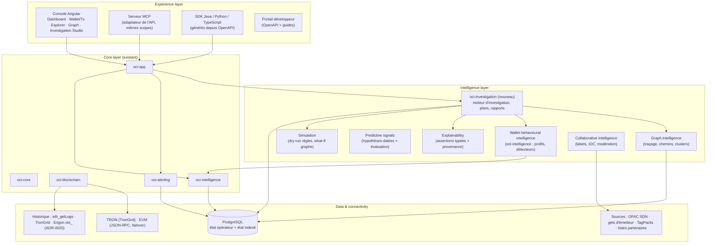

# Architecture cible

> Principe directeur : **faire évoluer le monolithe modulaire existant** (ADR-0001), pas le réécrire. Aucun
> microservice n'est ajouté tant qu'un besoin mesuré ne l'impose pas. Toute nouvelle dépendance est justifiée.

## 1. Vue en couches



## 2. Correspondance avec les modules existants

| Capacité cible | Où | Nature |
|---|---|---|
| Ingestion, adaptateurs, historique | `oci-blockchain` | existant ; ajouter failover (déjà codé), source Erigon `ots_` |
| Profils, détecteurs, scoring | `oci-intelligence` | existant ; interfaces de stockage à rendre persistantes |
| Règles, alertes, notifications, simulation de règles | `oci-alerting` | existant ; étendre `RuleTester` |
| Assertions typées (observé/inféré/prédit/confirmé) | `oci-core` | **nouveau type** partagé (ADR-0023) |
| Moteur d'investigation, rapports, dossiers | **`oci-investigation`** (nouveau module) | dépend de core, intelligence, alerting ; pas de Spring (comme les autres modules domaine) |
| Persistance JDBC de l'état indexé | `oci-app/persistence` | nouveaux stores derrière les interfaces existantes (ADR-0024) |
| API, sécurité, MCP | `oci-app` | MCP = adaptateur de transport supplémentaire, même autorisation |
| SDK | dépôt `sdk/` ou dépôts séparés | générés depuis l'OpenAPI, pas écrits à la main |

**Pourquoi un seul nouveau module** : l'investigation orchestre des capacités existantes et a son propre cycle de vie
(persistant, reprenable). Le graphe, la prédiction et la simulation sont d'abord des fonctions de `oci-intelligence`
et `oci-alerting` ; ils ne deviennent des modules que si leur taille le justifie.

## 3. Modèle de données cible (ajouts)

| Entité | Contenu | Raison |
|---|---|---|
| `indexer_checkpoints` | réseau, dernier bloc, fenêtre de réorg | reprise sans trou ni re-indexation (D2) |
| `value_flows` | flux observés (partitionnés par mois), index par adresse | profils, graphe, exposition, dry-run après redémarrage |
| `wallet_profiles`, `signals`, `risk_scores` | état dérivé, versionné par moteur | reproductibilité |
| `labels` | adresse, catégorie, source, fiabilité, preuve, observé le, expire le, révoqué | provenance (pilier F) |
| `assertions` | sujet, prédicat, valeur, niveau épistémique, confiance, preuves[], sources[], moteur@version, expire le | piliers C, E |
| `investigations` | entrée, paramètres, plan, statut, étapes, version moteur, auteur, validation humaine | pilier A |
| `investigation_artifacts` | graphe figé, rapport, assertions produites | rejouabilité |
| `audit_log` | qui, quoi, quand (opérations sensibles) | TODO existant `ApiKeyService:37` |

Volumétrie mesurée : ~290 000 événements en 3 jours sur 2 chaînes avec indexation partielle. PostgreSQL avec
partitionnement mensuel et rétention configurable suffit à ce stade ; ClickHouse reste l'option de l'ADR-0004 si un
seuil mesuré est dépassé.

## 4. Flux d'une investigation autonome (phase 3)

```mermaid
sequenceDiagram
  participant U as Analyste / agent
  participant API as API (scope investigation:write)
  participant INV as oci-investigation
  participant H as AddressHistoryService
  participant G as Graph / Intelligence
  participant DB as PostgreSQL
  U->>API: POST /investigations {address, profondeur, fenêtre}
  API->>INV: créer (paramètres, version moteur)
  INV->>DB: investigation PENDING
  INV->>H: charger l'historique (limites du nœud notées)
  INV->>G: contreparties, chemins multi-sauts, signaux, labels
  G-->>INV: faits observés + inférences (confiance, preuves)
  INV->>DB: assertions + graphe figé + étapes
  INV-->>U: rapport (observé / inféré / prédit / confirmé, limites, sources)
  U->>API: valider / rejeter des assertions ; créer une règle proposée
```

L'investigation est **interruptible et reprenable** (même mécanique que l'historique d'adresse : progression
persistée, idempotence, curseur).

## 5. Interface agents (phase 5)

- Le serveur MCP **n'a pas sa propre logique** : chaque outil MCP appelle un cas d'usage existant, sous les mêmes
  scopes que l'endpoint REST correspondant.
- Les données on-chain sont **non fiables** pour un LLM (noms de tokens, mémos, métadonnées) : elles sont renvoyées
  comme données typées, jamais comme instructions ; documenté comme risque d'injection de prompt
  ([TECHNICAL_RISKS.md](TECHNICAL_RISKS.md)).
- Opérations d'écriture (créer une règle, lancer une investigation) : scopes dédiés, journalisées dans `audit_log`.

## 6. Non-objectifs à ce stade

- Pas de Kafka (ADR-0006 : outbox PostgreSQL d'abord).
- Pas de base graphe dédiée (ADR-0005 : PostgreSQL d'abord).
- Pas de multi-tenant avant un besoin client (aujourd'hui mono-tenant, assumé).
- Pas de ML « boîte noire » pour le score de risque.

## 7. ADR proposés (statut *proposed*, à valider)

| ADR | Décision |
|---|---|
| [0021](../adr/0021-stablecoin-rail-focus.md) | Premier marché : surveillance auto-hébergée des rails stablecoin (TRON + EVM) |
| [0022](../adr/0022-investigations-as-reproducible-artifacts.md) | Investigations persistantes, reprenables, rejouables |
| [0023](../adr/0023-epistemic-levels-for-assertions.md) | Niveaux épistémiques : observé / inféré / prédit / confirmé |
| [0024](../adr/0024-persist-chain-derived-state.md) | Persister l'état dérivé de la chaîne dans PostgreSQL |
| [0025](../adr/0025-mcp-as-api-adapter.md) | MCP comme adaptateur de l'API, autorisation par opération |

Les numéros 0013-0019 restent réservés au chantier WSO2 API Manager décidé le 2026-11-06 et non démarré.
